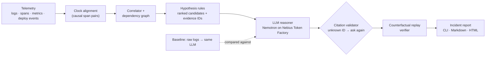

# Traceback

**Root-cause analysis you can check.** Traceback investigates a failed multi-service request: it rebuilds the
timeline, ranks likely root causes, cites the exact log/span/metric records behind every claim, separates
confirmed facts from hypotheses, and then **replays the incident with the suspected cause switched off** to see
whether the failure goes away.

Entry for the **Nebius × NVIDIA Global AI Hackathon**, track *Best Apps and Agents*.
Model: `nvidia/nemotron-3-super-120b-a12b` on **Nebius Token Factory**.

- **Live showcase (interactive):** https://actuallyanson.github.io/TraceBack/ (opens on a failing system; `make serve` locally, or `make live` to run the simulator and pipeline for real)
- **One-command demo:** `make demo` (no API key needed; see below)

## What Traceback claims, and what it doesn't

**Claimed: the answer is checkable and calibrated.** Every claim cites record IDs that exist, the suspected cause is replayed
switched-off, and an answer the replay cannot reproduce is not allowed to say "high" confidence. Measured against a raw-logs
baseline on the same model (tables below): **0% confidently wrong with the verifier versus 21.4% for the baseline on the second
topology** (7.7% on the first topology's held-out test set), at **about 1/13 of the cost** ($0.0043 versus $0.055 per incident
on the second topology), with every cited ID valid.

**Not claimed: higher accuracy.** On the first topology's held-out set the accuracy gaps are within one incident (n=26). On the
second topology (n=14) Full Traceback and the raw-logs baseline **tie at 78.6%**. The language-model stage did not improve on the
deterministic analyzer overall: on the second topology it helped once and hurt twice, and the replay verifier is what keeps
those wrong answers from being confident. All evaluation data comes from simulators.

## It is not a log summarizer

| Layer | What it does | Uses an LLM? |
|---|---|---|
| Clock alignment | Estimates each service's clock offset from causal span pairs | no |
| Correlator + dependency graph | Groups spans into traces, orders events, derives the call graph | no |
| Hypothesis rules | Ranked candidate causes, each linked to evidence IDs; changes with no following distress are "ruled out" | no |
| **LLM reasoner** | Ranks, explains and checks the candidates against their evidence; outputs a causal chain, a confidence label and *confirmed vs uncertain* per claim | **yes (Nemotron)** |
| Citation validator | Every cited record ID must exist in the incident; otherwise the answer is rejected and the model is asked again | no |
| Replay verifier | Re-runs the incident with the suspected cause disabled; reports whether the symptom disappears | no |

The analysis layer works without any model and is measured on its own. The model never sees the raw firehose,
only candidates and the records behind them. A **baseline** that feeds raw logs straight to the same model, with
the same output format, is measured against it.

## Architecture



## How Nemotron and Nebius Token Factory are used

- The reasoner and the baseline call the Token Factory OpenAI-compatible chat endpoint
  (`https://api.tokenfactory.nebius.com/v1/chat/completions`) from C++ with libcurl (`src/llm/`). The API key is read
  from the `NEBIUS_API_KEY` environment variable only; it is never written to disk or committed.
- Model: **`nvidia/nemotron-3-super-120b-a12b`** (NVIDIA Nemotron 3 Super) for every LLM result in this repo.
- Where Token Factory helped: the 262k-token context window lets the raw-logs baseline be a real competitor; per-token
  pricing made a full evaluation (every incident, both LLM systems, retries) cheap enough to rerun while iterating
  (the generated notes below give the total); the OpenAI-compatible API meant a thin client with no SDK. Details and rough edges are in
  `submission/FEEDBACK.md`.

## Quick start

Requirements: CMake ≥ 3.16, a C++20 compiler, libcurl, Python 3 (standard library only). Tested on macOS with Apple clang.

```bash
git clone https://github.com/ActuallyAnson/TraceBack && cd TraceBack
make build test     # builds everything and runs the unit tests (incl. the frozen test-split check)
make demo           # one incident end to end -> runs/demo/report.html and report.md
make serve          # the interactive showcase at http://localhost:8000 (recorded replays, labeled as such)
make live           # same UI, but "Trigger an outage" runs the simulator, analyzer and verifier for real
make data           # regenerate all 58 labeled incidents into runs/ (deterministic, ~5 s)
make results        # regenerate every reported number and refresh the table below
```

`make demo` and `make results` run **offline with no API key**: the model's recorded answers for every incident
used in the reported results are committed in `eval/llm_cache/` and are replayed by exact request match. To call the
model live (for example for a new incident), export a key and point at a cache directory:

```bash
export NEBIUS_API_KEY=...        # keep it in your shell profile, never in the repo
./build/tb_investigate runs/incidents/inc-009 --replay runs/replay/inc-009.json --cache eval/llm_cache
```

A cache miss (for example on another platform if prompt text differs, or after changing a prompt) makes a live call and
therefore needs the key.

## Results

All numbers are generated by `make results` (`eval/build_site.py` + `eval/make_results.py`) from saved runs; CI-style check:
`make results-check`. Scoring rules were committed before the first run (`eval/SCORING.md`). "Confidently wrong" =
answers the system labeled *high* confidence that were wrong, over all incidents. Test = held-out, locked before any model ran on it.

<!-- RESULTS:START (generated by eval/make_results.py; do not edit by hand) -->

**Held-out test split (headline)** (n=26)

| System | Top-1 | Precision when “high” | Confidently wrong | Cost / incident | Latency |
|---|---:|---:|---:|---:|---:|
| Raw logs → LLM (baseline) | 92.3% | 92.0% (25) | 7.7% | $0.048 | 20.3 s |
| Analyzer only (no LLM) | 96.2% | 100.0% (16) | 0.0% | $0 | <0.1 s |
| Analyzer + LLM (no verifier) | 96.2% | 100.0% (20) | 0.0% | $0.0038 | 13.8 s |
| **Full Traceback** (analyzer + LLM + verifier) | 96.2% | 100.0% (18) | 0.0% | $0.0038 | 13.8 s |

Top-1 by kind of test incident:

| System | Catalog fault types (n=16) | Unseen fault types (n=10, service localization only) |
|---|---:|---:|
| Raw logs → LLM (baseline) | 87.5% | 100.0% |
| Analyzer only (no LLM) | 100.0% | 90.0% |
| Analyzer + LLM (no verifier) | 93.8% | 100.0% |
| **Full Traceback** (analyzer + LLM + verifier) | 93.8% | 100.0% |

**Dev split (used for tuning; optimistic)** (n=32)

| System | Top-1 | Precision when “high” | Confidently wrong | Cost / incident | Latency |
|---|---:|---:|---:|---:|---:|
| Raw logs → LLM (baseline) | 81.2% | 83.9% (31) | 15.6% | $0.046 | 20.7 s |
| Analyzer only (no LLM) | 96.9% | 100.0% (24) | 0.0% | $0 | <0.1 s |
| Analyzer + LLM (no verifier) | 90.6% | 93.3% (30) | 6.2% | $0.0039 | 15.0 s |
| **Full Traceback** (analyzer + LLM + verifier) | 90.6% | 100.0% (28) | 0.0% | $0.0039 | 15.0 s |

Notes:

- Baseline as first run on test: 88.5%; one incident crashed the reply parser (a tool bug). After the fix and a re-run of that incident: 92.3% (shown above). See `eval/test_results/NOTES.md`.
- Baseline given the same prompt principles as Traceback: 88.5% top-1, 11.5% confidently wrong (test, n=26).
- Baseline on a 1M-context model for the 5 incidents whose input was truncated: 80.0% correct (thin evidence).
- Model usage behind every number in the main comparison (all 118 recorded calls, both LLM systems, all 58 incidents, retries included): 8.8M prompt + 0.32M completion tokens, about $2.94 at the listed Nemotron 3 Super price.
- Baseline input exceeded the model's context window and was sampled by trace for 5 of 26 test incidents and 13 of 32 dev incidents.

<!-- RESULTS:END -->

How to read this honestly:

- The held-out test set has **26 incidents**. A one-incident difference is 3.8 percentage points, so the accuracy gaps
  between systems are **not statistically meaningful**. The differences that hold up are confident-but-wrong answers,
  cost, and the checkability of the evidence.
- The LLM stage did **not** improve on the analyzer's accuracy; it adds a causal chain with cited evidence and
  confirmed/uncertain labels, and on dev it sometimes overrode a correct analyzer answer. The replay verifier lowers
  confidence on answers it cannot reproduce; it never changes an answer.
- "Unseen" fault types are scored on locating the right service only (see `eval/SCORING.md`), which is lenient.
- Traceback's prompt was tuned on the dev split over three iterations; the baseline prompt was written once. An ablation
  gives the baseline the same prompt principles.

## Evaluation data: a simulator (what that does and doesn't prove)

Incidents come from a deterministic discrete-event simulator of one small backend (`src/sim/`): gateway → orders →
inventory / payments, with worker queues, connection pools, timeouts and retries. It emits only structured JSON logs,
spans, metrics and ops events. Ground truth is written to a separate directory the analyzer never reads, and the simulator
shares no code with the analyzer. The data includes background noise, dropped log lines and spans, missing trace IDs,
clock skew, misleading symptoms (the error surfaces in one service, the cause is in another) and decoy faults.

- 58 labeled incidents: 8 catalog fault types × (4 plain + 1 with clock skew + 1 with a decoy), plus 10 incidents of 6
  fault types outside the catalog (network partition, DNS failure, crash loop, silent regression, slow subset of requests,
  gradual degradation) that went to the test split only, after the analyzer rules were frozen.
- 32 dev incidents (used for tuning) and 26 held-out test incidents, frozen in `eval/split.json` with content hashes;
  `make verify` fails if regenerated data drifts. Every change to the lock is in `eval/LOCK_HISTORY.md`.
- Every incident is kept only if the symptom is visible **and** removing the true cause makes it disappear.

What this proves: the pipeline handles the failure patterns, noise and clock skew modeled here, scored against exact
ground truth. What it does not prove: that it works on real production telemetry, other architectures or other log formats.
The 58 incidents above all use one simulated topology. A separate generalization check on a second, differently shaped topology is reported in the next section.

## Generalization check: a second topology

The analyzer and prompts were built and tuned on a request chain (gateway → orders → inventory/payments). To see whether they
transfer, I added a second simulator with a different call pattern: an **event-driven fan-out** with a message broker (6 services:
api → ingest → broker → billing and shipping in parallel, plus a fire-and-forget notifier). The plan and the no-tuning rules were committed
before any incident existed (`eval/topology2/PLAN.md`); the 14 incidents were locked before any system ran on them; and the analyzer and
prompts are byte-identical to their pre-experiment hashes (`eval/topology2/check_frozen.sh`). The only thing supplied per incident is a one-sentence
architecture description in `meta.json`, which replaces the first paragraph of the system prompt (that paragraph names topology 1's services).
Reproduce with `make topology2`.

<!-- TOPOLOGY2:START (generated by eval/topology2/report.py; do not edit by hand) -->

**Second topology (event-driven fan-out, 6 services), n=14, analyzer and prompts unchanged**

| System | Top-1 | Precision when “high” | Confidently wrong | Cost / incident | Latency |
|---|---:|---:|---:|---:|---:|
| Raw logs → LLM (baseline) | 78.6% | 76.9% (13) | 21.4% | $0.055 | 23.5 s |
| Analyzer only (no LLM) | 85.7% | 100.0% (8) | 0.0% | $0 | <0.1 s |
| Analyzer + LLM (no verifier) | 78.6% | 76.9% (13) | 21.4% | $0.0043 | 16.5 s |
| **Full Traceback** (analyzer + LLM + verifier) | 78.6% | 100.0% (10) | 0.0% | $0.0043 | 16.5 s |

Top-1 by group:

| Group (n) | Baseline | Analyzer | Analyzer + LLM |
|---|---:|---:|---:|
| decoy (2) | 50.0% | 0.0% | 50.0% |
| plain (11) | 81.8% | 100.0% | 81.8% |
| skew (1) | 100.0% | 100.0% | 100.0% |

Every incident (✓ = top-1 correct; the answer is shown for every ✗). Truth is the labeled cause; “replay” is the verifier's verdict on the LLM's answer:

| Incident | Truth (service) | Analyzer | Baseline | Analyzer + LLM (confidence → after replay) |
|---|---|---|---|---|
| fan-01 (plain) | slow_dependency (billing) | ✓ | ✗ pool_exhaustion/billing | ✓ (high → high; replay passed) |
| fan-02 (decoy) | slow_dependency (billing) | ✗ deploy_regression/notifier | ✗ pool_exhaustion/billing | ✗ internal_errors/billing (high → medium; replay inconclusive) |
| fan-03 (plain) | bad_deploy (shipping) | ✓ | ✓ | ✓ (high → high; replay passed) |
| fan-04 (skew) | bad_deploy (shipping) | ✓ | ✓ | ✓ (high → high; replay passed) |
| fan-05 (plain) | crash_restart (billing) | ✓ | ✓ | ✓ (high → high; replay passed) |
| fan-06 (plain) | connection_pool_exhaustion (billing) | ✓ | ✓ | ✓ (high → high; replay passed) |
| fan-07 (plain) | config_change (broker) | ✓ | ✓ | ✓ (high → high; replay passed) |
| fan-08 (plain) | capacity_reduction (broker) | ✓ | ✓ | ✗ edge_unreachable/ingest (high → medium; replay inconclusive) |
| fan-09 (plain) | retry_storm (broker) | ✓ | ✗ capacity_saturation/billing | ✗ internal_errors/billing (high → medium; replay inconclusive) |
| fan-10 (plain) | masked_downstream_error (shipping) | ✓ | ✓ | ✓ (medium → medium; replay passed) |
| fan-11 (plain) | network_partition (shipping broker→shipping) | ✓ | ✓ | ✓ (high → high; replay passed) |
| fan-12 (decoy) | network_partition (billing broker→billing) | ✗ deploy_regression/api | ✓ | ✓ (high → high; replay passed) |
| fan-13 (plain) | silent_regression (ingest) | ✓ | ✓ | ✓ (high → high; replay passed) |
| fan-14 (plain) | crash_loop (shipping) | ✓ | ✓ | ✓ (high → high; replay passed) |

Baseline input exceeded the context window and was sampled by trace for 4 of 14 incidents. Unmapped fault types (network partition, crash loop, silent regression) are scored on service localization only, as in the first topology.

<!-- TOPOLOGY2:END -->

What this shows (my reading; n=14, so treat it as qualitative):

- **Accuracy dropped for every system** relative to the first topology. Full Traceback has **no accuracy advantage** over the raw-logs
  baseline here: they tie at 78.6% (n=14, a one-incident gap is 7 points). The pipeline transfers partially, not cleanly.
- **Analyzer: perfect on the 11 plain incidents, 0 of 2 on the decoy incidents.** Two specific flaws, both new failure modes:
  (1) a decoy deploy on the fire-and-forget notifier produces errors that never reach users but appear inside many failing traces, which inflates the
  analyzer's "share of failed traces touched" score and lets the decoy outrank the real cause (fan-02);
  (2) a harmless deploy on the *entry* service looks like a regression because every user-visible failure surfaces there (fan-12).
  The coverage score checks that an anomaly is *present* in a failing trace, not that it is on the path that failed. I did not fix this (no tuning); it is the obvious next improvement.
- **The LLM stage helped once and hurt twice, and the verifier is what keeps wrong answers from being confident.** It fixed fan-12, but overruled correct analyzer answers on fan-08 (a throttled broker became "edge unreachable at ingest") and
  fan-09 (a retry storm named by its billing trigger; the same trigger-versus-amplifier ambiguity as on the first topology).
- **The raw-logs baseline repeats a first-topology mistake**: it blames pool exhaustion when the pool is saturated *because* the service got slow (fan-01, fan-02).
- **What did hold up:** with the replay verifier, no answer was confidently wrong (all three wrong answers were capped to medium confidence because the replay had no matching condition),
  against roughly one in five for the baseline and for the unverified LLM; the model cost per incident stayed about an order of magnitude lower than the baseline's;
  every cited record ID existed; and clock skew on the one skewed incident was recovered to a few milliseconds.
- The verifier is conservative rather than clever here: a wrong answer was never *rejected* by a failed replay, only left unverified.

## The interactive demo (failure first)

The site opens on **The outage**: a simulated production failure, then the obvious approach (raw logs into the model, its actual
recorded reply shown verbatim), then the same incident through Traceback. It is deliberately not a highlight reel: the guided tour
includes `inc-003`, where Traceback is **wrong** and says it is not sure (the analyzer's top candidate was right and the model overruled it;
the replay was inconclusive, so confidence was capped at medium). "Random held-out outage" draws uniformly from the 26 test incidents with no
filtering, and a running tally counts the misses.

The **Second topology** tab shows the generalization check on the six-service fan-out: all 14 incidents, each system's answer, the truth, and where the decoy failures are (data generated by `make topology2` into `docs/data/topology2.json`).

Provenance is on screen at all times. On the static site (GitHub Pages) the label reads **SIMULATED · RECORDED REPLAY**: nothing runs in your
browser. With `make live` it reads **SIMULATED · RUN LIVE**: the simulator generates the incident, then the analyzer, citation check and replay
verifier run on your machine. Model answers are the recorded ones unless you tick "Call the model live" (needs `NEBIUS_API_KEY`); that call has a hard time
limit (`TB_LIVE_MODEL_TIMEOUT`, default 60 s) and falls back to the recorded answer, clearly marked "RECORDED FALLBACK".

## Future work

- Fix the analyzer's coverage score so errors on fire-and-forget branches and harmless deploys on the entry service stop outranking real causes
  (the two decoy failures on the second topology, fan-02 and fan-12). Deliberately not fixed here: the generalization check ran with no tuning.
- Decide when the model should be allowed to overrule the analyzer (it hurt twice on the second topology and sometimes on the first).
- Make the verifier able to reject, not only decline to confirm, wrong answers; today it never rejected one in the reported runs.
- Adapters for real log schemas and replay against canary or feature-flag rollbacks.

## Honest limitations

- One simulated four-service topology; no real production data (see above).
- The verifier needs a replayable environment (in production: a canary or feature-flag rollback). On a single-fault
  incident its manifest has one condition, so a matching hypothesis passing is partly by construction; the informative
  cases are double faults and wrong-service answers.
- The raw-logs baseline's input exceeded the model's context window for some incidents and was sampled by trace group
  (counts in the notes above); a larger-context sensitivity check on the truncated test incidents showed no accuracy change but is thin.
- Model output is not fully deterministic at temperature 0; committed answers are what the results were computed from.
- Rules use domain conventions (event names such as `pool_exhausted`, `retry_scheduled`) and may need adapting to other log schemas.

## Repository layout

```
src/sim/        simulator, fault catalog, ground truth, replay environment
src/analyzer/   loader, clock estimator, correlator, dependency graph, hypothesis rules  (no LLM, no labels)
src/llm/        libcurl client + response cache, reasoner, raw-telemetry baseline
src/verify/     counterfactual replay verifier
src/report/     tb_investigate: analysis -> LLM -> verification -> report (CLI, Markdown, HTML)
prompts/        system prompts and output format (written before results; see eval/SCORING.md)
eval/           scoring protocol, split lock, harness, results generator, committed model-answer cache, test-run log
docs/           interactive showcase site (static; data generated by eval/build_site.py)
tests/          unit tests (C++) and a UI smoke test (tests/ui)
submission/     hackathon checklist, Devpost description, video outline, product feedback
```

Tests: `make test` (simulator determinism and label-leak check, analyzer clock-skew/correlator/citation tests, verifier tests,
frozen-split check). Third-party code: `third_party/nlohmann/json.hpp` (MIT).

## License

MIT, see `LICENSE`.
