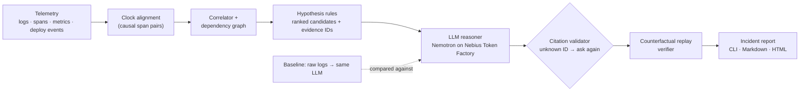

# Traceback

**Root-cause analysis you can check.** Traceback investigates a failed multi-service request: it rebuilds the
timeline, ranks likely root causes, cites the exact log/span/metric records behind every claim, separates
confirmed facts from hypotheses, and then **replays the incident with the suspected cause switched off** to see
whether the failure goes away.

Entry for the **Nebius × NVIDIA Global AI Hackathon**, track *Best Apps and Agents*.
Model: `nvidia/nemotron-3-super-120b-a12b` on **Nebius Token Factory**.

- **Live showcase (interactive):** https://actuallyanson.github.io/TraceBack/ (opens on a failing system; `make serve` locally, or `make live` to run the simulator and pipeline for real)
- **One-command demo:** `make demo` (no API key needed; see below)

## Status at a glance (2026-10-20)

- **Simulated incidents, fresh locked sets (48):** Full Traceback v2 finds the cause in **95.8%** (raw-logs baseline 68.8%), with **0% confidently wrong** (baseline 29.2%), at about a tenth of the baseline's cost per incident. The deterministic analyzer alone is also 95.8%: the language model adds checkable explanations and calibration, not accuracy.
- **Real telemetry (OpenTelemetry Demo, five batches):** the pipeline runs, but it localizes **less** well than the raw-logs baseline: analyzers and Full Traceback 0 to 1 of 7-10 faults on batches 1 to 3, 2 of 10 after a converter fix (batch 4), 3 of 10 with the origin-candidate generator on fresh batch 5, against 5 of 10 for the baseline in every batch. Clean runs still raise false medium alarms. See "Real telemetry check".
- **The replay verifier needs the simulator**, so on real data it cannot check anything.
- Every number below is generated from saved runs (`make results-check` and the other `*-check` targets reproduce them offline) and every wrong answer is listed.

## What Traceback claims, and what it doesn't

**Claimed: the answer is checkable and calibrated.** Every claim cites record IDs that exist, the suspected cause is replayed
switched-off, and an answer the replay cannot reproduce is not allowed to say "high" confidence. Measured against a raw-logs
baseline on the same model (tables below): **0% confidently wrong with the verifier versus 21.4% for the baseline on the second
topology** (7.7% on the first topology's held-out test set), at **about 1/13 of the cost** ($0.0043 versus $0.055 per incident
on the second topology), with every cited ID valid.

**Not claimed: higher accuracy.** On the first topology's held-out set the accuracy gaps are within one incident (n=26). On the
second topology (n=14) Full Traceback and the raw-logs baseline **tie at 78.6%**. The language-model stage did not improve on the
deterministic analyzer overall: on the second topology it helped once and hurt twice, and the replay verifier is what keeps
those wrong answers from being confident. All evaluation data comes from simulators.

## It is not a log summarizer

| Layer | What it does | Uses an LLM? |
|---|---|---|
| Clock alignment | Estimates each service's clock offset from causal span pairs | no |
| Correlator + dependency graph | Groups spans into traces, orders events, derives the call graph | no |
| Hypothesis rules | Ranked candidate causes, each linked to evidence IDs; changes with no following distress are "ruled out" | no |
| **LLM reasoner** | Ranks, explains and checks the candidates against their evidence; outputs a causal chain, a confidence label and *confirmed vs uncertain* per claim | **yes (Nemotron)** |
| Citation validator | Every cited record ID must exist in the incident; otherwise the answer is rejected and the model is asked again | no |
| Replay verifier | Re-runs the incident with the suspected cause disabled; reports whether the symptom disappears | no |

The analysis layer works without any model and is measured on its own. The model never sees the raw firehose,
only candidates and the records behind them. A **baseline** that feeds raw logs straight to the same model, with
the same output format, is measured against it.

## Architecture



## How Nemotron and Nebius Token Factory are used

- The reasoner and the baseline call the Token Factory OpenAI-compatible chat endpoint
  (`https://api.tokenfactory.nebius.com/v1/chat/completions`) from C++ with libcurl (`src/llm/`). The API key is read
  from the `NEBIUS_API_KEY` environment variable only; it is never written to disk or committed.
- Model: **`nvidia/nemotron-3-super-120b-a12b`** (NVIDIA Nemotron 3 Super) for every LLM result in this repo.
- Where Token Factory helped: the 262k-token context window lets the raw-logs baseline be a real competitor; per-token
  pricing made a full evaluation (every incident, both LLM systems, retries) cheap enough to rerun while iterating
  (the generated notes below give the total); the OpenAI-compatible API meant a thin client with no SDK. Details and rough edges are in
  `submission/FEEDBACK.md`.

## Quick start

Requirements: CMake ≥ 3.16, a C++20 compiler, libcurl, Python 3 (standard library only). Tested on macOS with Apple clang.

```bash
git clone https://github.com/ActuallyAnson/TraceBack && cd TraceBack
make build test     # builds everything and runs the unit tests (incl. the frozen test-split check)
make demo           # one incident end to end -> runs/demo/report.html and report.md
make serve          # the interactive showcase at http://localhost:8000 (recorded replays, labeled as such)
make live           # same UI, but "Trigger an outage" runs the simulator, analyzer and verifier for real
make data           # regenerate all 58 labeled incidents into runs/ (deterministic, ~5 s)
make results        # regenerate every reported number and refresh the table below
```

`make demo` and `make results` run **offline with no API key**: the model's recorded answers for every incident
used in the reported results are committed in `eval/llm_cache/` and are replayed by exact request match. To call the
model live (for example for a new incident), export a key and point at a cache directory:

```bash
export NEBIUS_API_KEY=...        # keep it in your shell profile, never in the repo
./build/tb_investigate runs/incidents/inc-009 --replay runs/replay/inc-009.json --cache eval/llm_cache
```

A cache miss (for example on another platform if prompt text differs, or after changing a prompt) makes a live call and
therefore needs the key.

## Results

All numbers are generated by `make results` (`eval/build_site.py` + `eval/make_results.py`) from saved runs; CI-style check:
`make results-check`. Scoring rules were committed before the first run (`eval/SCORING.md`). "Confidently wrong" =
answers the system labeled *high* confidence that were wrong, over all incidents. Test = held-out, locked before any model ran on it.

<!-- RESULTS:START (generated by eval/make_results.py; do not edit by hand) -->

**Held-out test split (headline)** (n=26)

| System | Top-1 | Precision when “high” | Confidently wrong | Cost / incident | Latency |
|---|---:|---:|---:|---:|---:|
| Raw logs → LLM (baseline) | 92.3% | 92.0% (25) | 7.7% | $0.048 | 20.3 s |
| Analyzer only (no LLM) | 96.2% | 100.0% (16) | 0.0% | $0 | <0.1 s |
| Analyzer + LLM (no verifier) | 96.2% | 100.0% (20) | 0.0% | $0.0038 | 13.8 s |
| **Full Traceback** (analyzer + LLM + verifier) | 96.2% | 100.0% (18) | 0.0% | $0.0038 | 13.8 s |

Top-1 by kind of test incident:

| System | Catalog fault types (n=16) | Unseen fault types (n=10, service localization only) |
|---|---:|---:|
| Raw logs → LLM (baseline) | 87.5% | 100.0% |
| Analyzer only (no LLM) | 100.0% | 90.0% |
| Analyzer + LLM (no verifier) | 93.8% | 100.0% |
| **Full Traceback** (analyzer + LLM + verifier) | 93.8% | 100.0% |

**Dev split (used for tuning; optimistic)** (n=32)

| System | Top-1 | Precision when “high” | Confidently wrong | Cost / incident | Latency |
|---|---:|---:|---:|---:|---:|
| Raw logs → LLM (baseline) | 81.2% | 83.9% (31) | 15.6% | $0.046 | 20.7 s |
| Analyzer only (no LLM) | 96.9% | 100.0% (24) | 0.0% | $0 | <0.1 s |
| Analyzer + LLM (no verifier) | 90.6% | 93.3% (30) | 6.2% | $0.0039 | 15.0 s |
| **Full Traceback** (analyzer + LLM + verifier) | 90.6% | 100.0% (28) | 0.0% | $0.0039 | 15.0 s |

Notes:

- Baseline as first run on test: 88.5%; one incident crashed the reply parser (a tool bug). After the fix and a re-run of that incident: 92.3% (shown above). See `eval/test_results/NOTES.md`.
- Baseline given the same prompt principles as Traceback: 88.5% top-1, 11.5% confidently wrong (test, n=26).
- Baseline on a 1M-context model for the 5 incidents whose input was truncated: 80.0% correct (thin evidence).
- Model usage behind every number in the main comparison (all 118 recorded calls, both LLM systems, all 58 incidents, retries included): 8.8M prompt + 0.32M completion tokens, about $2.94 at the listed Nemotron 3 Super price.
- Baseline input exceeded the model's context window and was sampled by trace for 5 of 26 test incidents and 13 of 32 dev incidents.

<!-- RESULTS:END -->

How to read this honestly:

- The held-out test set has **26 incidents**. A one-incident difference is 3.8 percentage points, so the accuracy gaps
  between systems are **not statistically meaningful**. The differences that hold up are confident-but-wrong answers,
  cost, and the checkability of the evidence.
- The LLM stage did **not** improve on the analyzer's accuracy; it adds a causal chain with cited evidence and
  confirmed/uncertain labels, and on dev it sometimes overrode a correct analyzer answer. The replay verifier lowers
  confidence on answers it cannot reproduce; it never changes an answer.
- "Unseen" fault types are scored on locating the right service only (see `eval/SCORING.md`), which is lenient.
- Traceback's prompt was tuned on the dev split over three iterations; the baseline prompt was written once. An ablation
  gives the baseline the same prompt principles.

## Evaluation data: a simulator (what that does and doesn't prove)

Incidents come from a deterministic discrete-event simulator of one small backend (`src/sim/`): gateway → orders →
inventory / payments, with worker queues, connection pools, timeouts and retries. It emits only structured JSON logs,
spans, metrics and ops events. Ground truth is written to a separate directory the analyzer never reads, and the simulator
shares no code with the analyzer. The data includes background noise, dropped log lines and spans, missing trace IDs,
clock skew, misleading symptoms (the error surfaces in one service, the cause is in another) and decoy faults.

- 58 labeled incidents: 8 catalog fault types × (4 plain + 1 with clock skew + 1 with a decoy), plus 10 incidents of 6
  fault types outside the catalog (network partition, DNS failure, crash loop, silent regression, slow subset of requests,
  gradual degradation) that went to the test split only, after the analyzer rules were frozen.
- 32 dev incidents (used for tuning) and 26 held-out test incidents, frozen in `eval/split.json` with content hashes;
  `make verify` fails if regenerated data drifts. Every change to the lock is in `eval/LOCK_HISTORY.md`.
- Every incident is kept only if the symptom is visible **and** removing the true cause makes it disappear.

What this proves: the pipeline handles the failure patterns, noise and clock skew modeled here, scored against exact
ground truth. What it does not prove: that it works on real production telemetry, other architectures or other log formats.
The 58 incidents above all use one simulated topology. A separate generalization check on a second, differently shaped topology is reported in the next section.

## Generalization check: a second topology

The analyzer and prompts were built and tuned on a request chain (gateway → orders → inventory/payments). To see whether they
transfer, I added a second simulator with a different call pattern: an **event-driven fan-out** with a message broker (6 services:
api → ingest → broker → billing and shipping in parallel, plus a fire-and-forget notifier). The plan and the no-tuning rules were committed
before any incident existed (`eval/topology2/PLAN.md`); the 14 incidents were locked before any system ran on them; and the analyzer and
prompts are byte-identical to their pre-experiment hashes (`eval/topology2/check_frozen.sh`). The only thing supplied per incident is a one-sentence
architecture description in `meta.json`, which replaces the first paragraph of the system prompt (that paragraph names topology 1's services).
Reproduce with `make topology2`.

<!-- TOPOLOGY2:START (generated by eval/topology2/report.py; do not edit by hand) -->

**Second topology (event-driven fan-out, 6 services), n=14, analyzer and prompts unchanged**

| System | Top-1 | Precision when “high” | Confidently wrong | Cost / incident | Latency |
|---|---:|---:|---:|---:|---:|
| Raw logs → LLM (baseline) | 78.6% | 76.9% (13) | 21.4% | $0.055 | 23.5 s |
| Analyzer only (no LLM) | 85.7% | 100.0% (8) | 0.0% | $0 | <0.1 s |
| Analyzer + LLM (no verifier) | 78.6% | 76.9% (13) | 21.4% | $0.0043 | 16.5 s |
| **Full Traceback** (analyzer + LLM + verifier) | 78.6% | 100.0% (10) | 0.0% | $0.0043 | 16.5 s |

Top-1 by group:

| Group (n) | Baseline | Analyzer | Analyzer + LLM |
|---|---:|---:|---:|
| decoy (2) | 50.0% | 0.0% | 50.0% |
| plain (11) | 81.8% | 100.0% | 81.8% |
| skew (1) | 100.0% | 100.0% | 100.0% |

Every incident (✓ = top-1 correct; the answer is shown for every ✗). Truth is the labeled cause; “replay” is the verifier's verdict on the LLM's answer:

| Incident | Truth (service) | Analyzer | Baseline | Analyzer + LLM (confidence → after replay) |
|---|---|---|---|---|
| fan-01 (plain) | slow_dependency (billing) | ✓ | ✗ pool_exhaustion/billing | ✓ (high → high; replay passed) |
| fan-02 (decoy) | slow_dependency (billing) | ✗ deploy_regression/notifier | ✗ pool_exhaustion/billing | ✗ internal_errors/billing (high → medium; replay inconclusive) |
| fan-03 (plain) | bad_deploy (shipping) | ✓ | ✓ | ✓ (high → high; replay passed) |
| fan-04 (skew) | bad_deploy (shipping) | ✓ | ✓ | ✓ (high → high; replay passed) |
| fan-05 (plain) | crash_restart (billing) | ✓ | ✓ | ✓ (high → high; replay passed) |
| fan-06 (plain) | connection_pool_exhaustion (billing) | ✓ | ✓ | ✓ (high → high; replay passed) |
| fan-07 (plain) | config_change (broker) | ✓ | ✓ | ✓ (high → high; replay passed) |
| fan-08 (plain) | capacity_reduction (broker) | ✓ | ✓ | ✗ edge_unreachable/ingest (high → medium; replay inconclusive) |
| fan-09 (plain) | retry_storm (broker) | ✓ | ✗ capacity_saturation/billing | ✗ internal_errors/billing (high → medium; replay inconclusive) |
| fan-10 (plain) | masked_downstream_error (shipping) | ✓ | ✓ | ✓ (medium → medium; replay passed) |
| fan-11 (plain) | network_partition (shipping broker→shipping) | ✓ | ✓ | ✓ (high → high; replay passed) |
| fan-12 (decoy) | network_partition (billing broker→billing) | ✗ deploy_regression/api | ✓ | ✓ (high → high; replay passed) |
| fan-13 (plain) | silent_regression (ingest) | ✓ | ✓ | ✓ (high → high; replay passed) |
| fan-14 (plain) | crash_loop (shipping) | ✓ | ✓ | ✓ (high → high; replay passed) |

Baseline input exceeded the context window and was sampled by trace for 4 of 14 incidents. Unmapped fault types (network partition, crash loop, silent regression) are scored on service localization only, as in the first topology.

<!-- TOPOLOGY2:END -->

What this shows (my reading; n=14, so treat it as qualitative):

- **Accuracy dropped for every system** relative to the first topology. Full Traceback has **no accuracy advantage** over the raw-logs
  baseline here: they tie at 78.6% (n=14, a one-incident gap is 7 points). The pipeline transfers partially, not cleanly.
- **Analyzer: perfect on the 11 plain incidents, 0 of 2 on the decoy incidents.** Two specific flaws, both new failure modes:
  (1) a decoy deploy on the fire-and-forget notifier produces errors that never reach users but appear inside many failing traces, which inflates the
  analyzer's "share of failed traces touched" score and lets the decoy outrank the real cause (fan-02);
  (2) a harmless deploy on the *entry* service looks like a regression because every user-visible failure surfaces there (fan-12).
  The coverage score checks that an anomaly is *present* in a failing trace, not that it is on the path that failed. I did not fix this (no tuning); it is the obvious next improvement.
- **The LLM stage helped once and hurt twice, and the verifier is what keeps wrong answers from being confident.** It fixed fan-12, but overruled correct analyzer answers on fan-08 (a throttled broker became "edge unreachable at ingest") and
  fan-09 (a retry storm named by its billing trigger; the same trigger-versus-amplifier ambiguity as on the first topology).
- **The raw-logs baseline repeats a first-topology mistake**: it blames pool exhaustion when the pool is saturated *because* the service got slow (fan-01, fan-02).
- **What did hold up:** with the replay verifier, no answer was confidently wrong (all three wrong answers were capped to medium confidence because the replay had no matching condition),
  against roughly one in five for the baseline and for the unverified LLM; the model cost per incident stayed about an order of magnitude lower than the baseline's;
  every cited record ID existed; and clock skew on the one skewed incident was recovered to a few milliseconds.
- The verifier is conservative rather than clever here: a wrong answer was never *rejected* by a failed replay, only left unverified.

## The interactive demo (failure first)

The site opens on **The outage**: a simulated production failure, then the obvious approach (raw logs into the model, its actual
recorded reply shown verbatim), then the same incident through Traceback. It is deliberately not a highlight reel: the guided tour
includes `inc-003`, where Traceback is **wrong** and says it is not sure (the analyzer's top candidate was right and the model overruled it;
the replay was inconclusive, so confidence was capped at medium). "Random held-out outage" draws uniformly from the 26 test incidents with no
filtering, and a running tally counts the misses.

The **Second topology** tab shows the generalization check on the six-service fan-out: all 14 incidents, each system's answer, the truth, and where the decoy failures are (data generated by `make topology2` into `docs/data/topology2.json`).

Provenance is on screen at all times. On the static site (GitHub Pages) the label reads **SIMULATED · RECORDED REPLAY**: nothing runs in your
browser. With `make live` it reads **SIMULATED · RUN LIVE**: the simulator generates the incident, then the analyzer, citation check and replay
verifier run on your machine. Model answers are the recorded ones unless you tick "Call the model live" (needs `NEBIUS_API_KEY`); that call has a hard time
limit (`TB_LIVE_MODEL_TIMEOUT`, default 60 s) and falls back to the recorded answer, clearly marked "RECORDED FALLBACK".

## Accuracy improvements (v2)

The v1 results above (and the topology-2 check) are unchanged: same tables, same locked test sets, same frozen analyzer and prompts (`sh eval/v2/check_v1.sh`, git tag `v1-frozen`). v2 was built **after seeing v1's failures**, so v1's test numbers say nothing about v2, and v2 is **evaluated only on fresh incidents**: 24 per topology (6 of them with the new retry-storm variants, 16 decoy cases in total), generated with new seeds and locked together with their ground truth in commit `67e9729` before any system was run on them (`eval/v2/FRESH_LOCK`). The plan, the failure list and its two dated amendments were committed before the run (`eval/v2/PLAN.md`). v2 was developed on a separate dev-v2 set with other seeds, which is not evidence. Nothing was changed after the fresh run.

What changed in v2 (new files; v1 still runs exactly as before):

- **Analyzer v2** = the frozen v1 analyzer plus two causal re-ranking rules. (1) *Origin share:* a deploy / internal-errors / slow-service hypothesis is demoted when under 10% of failed requests originate in that service while another service originates at least half. (2) *Upstream effect:* a generic symptom on a service is demoted when a specific cause (a worker-limit drop, a crash, a pool, a deploy, a config change) that began no later sits on a service it calls.
- **Reasoner v2** (`prompts_v2/`): the model must confirm the analyzer's top candidate unless it cites records that contradict it; the check is mechanical (the records must exist, belong to that candidate's own service, fall inside its time window and not be its own evidence), and an unjustified override gets one corrective retry and is then replaced by the analyzer's choice.
- Not changed, on purpose: a pool-ordering rule was tried on dev-v2 and dropped because it demoted a true pool exhaustion; a "does the failure rate change when this service is anomalous" test was tried and dropped because it broke on latency cascades (both are recorded in the plan).

Results on the fresh sets (both topologies pooled, then each topology, then every incident, including every wrong answer):

<!-- V2:START (generated by eval/v2/report.py; do not edit by hand) -->

**v2 on the fresh sets: 48 incidents (24 per topology), generated and locked before any system ran on them** (`eval/v2/FRESH_LOCK`). Both topologies pooled:

| System | Top-1 | Precision when “high” | Confidently wrong | Citations that exist | Decoy cases top-1 | Cost / incident |
|---|---:|---:|---:|---:|---:|---:|
| Raw logs → LLM (baseline) | 68.8% | 70.2% (47) | 29.2% | 100.0% | 62.5% (10/16) | $0.050 |
| Analyzer v1 (frozen) | 93.8% | 100.0% (27) | 0.0% | – | 87.5% (14/16) | $0 |
| Analyzer v2 | 95.8% | 100.0% (27) | 0.0% | – | 93.8% (15/16) | $0 |
| Full Traceback v1 | 75.0% | 100.0% (31) | 0.0% | 100.0% | 87.5% (14/16) | $0.0041 |
| **Full Traceback v2** | 95.8% | 100.0% (35) | 0.0% | 100.0% | 93.8% (15/16) | $0.0048 |

Topology 1 (4 services), n=24:

| System | Top-1 | Precision when “high” | Confidently wrong | Citations that exist | Decoy cases top-1 | Cost / incident |
|---|---:|---:|---:|---:|---:|---:|
| Raw logs → LLM (baseline) | 75.0% | 78.3% (23) | 20.8% | 100.0% | 62.5% (5/8) | $0.044 |
| Analyzer v1 (frozen) | 100.0% | 100.0% (17) | 0.0% | – | 100.0% (8/8) | $0 |
| Analyzer v2 | 100.0% | 100.0% (17) | 0.0% | – | 100.0% (8/8) | $0 |
| Full Traceback v1 | 83.3% | 100.0% (19) | 0.0% | 100.0% | 87.5% (7/8) | $0.0035 |
| **Full Traceback v2** | 100.0% | 100.0% (22) | 0.0% | 100.0% | 100.0% (8/8) | $0.0042 |

Topology 2 (6-service fan-out), n=24:

| System | Top-1 | Precision when “high” | Confidently wrong | Citations that exist | Decoy cases top-1 | Cost / incident |
|---|---:|---:|---:|---:|---:|---:|
| Raw logs → LLM (baseline) | 62.5% | 62.5% (24) | 37.5% | 100.0% | 62.5% (5/8) | $0.057 |
| Analyzer v1 (frozen) | 87.5% | 100.0% (10) | 0.0% | – | 75.0% (6/8) | $0 |
| Analyzer v2 | 91.7% | 100.0% (10) | 0.0% | – | 87.5% (7/8) | $0 |
| Full Traceback v1 | 66.7% | 100.0% (12) | 0.0% | 100.0% | 87.5% (7/8) | $0.0047 |
| **Full Traceback v2** | 91.7% | 100.0% (13) | 0.0% | 100.0% | 87.5% (7/8) | $0.0055 |

Top-1 by kind of incident (Analyzer v1 / Analyzer v2 / Full Traceback v1 / Full Traceback v2 / baseline):

| Group (n) | Baseline | Analyzer v1 | Analyzer v2 | Full Traceback v1 | Full Traceback v2 |
|---|---:|---:|---:|---:|---:|
| plain (16) | 87.5% | 100.0% | 100.0% | 75.0% | 100.0% |
| skew (6) | 83.3% | 83.3% | 100.0% | 50.0% | 100.0% |
| storm_variant (6) | 0.0% | 100.0% | 100.0% | 50.0% | 83.3% |
| decoy (16) | 62.5% | 87.5% | 93.8% | 87.5% | 93.8% |
| unseen (4) | 100.0% | 100.0% | 75.0% | 100.0% | 100.0% |

Override rule in Full Traceback v2: the model differed from the analyzer's top candidate in 2 of 48 incidents (0 of those answers were replaced by the analyzer's choice for lacking contradicting records); in v1 the model differed in 15.

Every incident (✓ = top-1 correct; the answer is shown for every ✗; for the two Full Traceback systems: confidence after the verifier, replay verdict on the model's answer):

| Incident | Truth (service) | Baseline | Analyzer v1 | Analyzer v2 | Full Traceback v1 | Full Traceback v2 |
|---|---|---|---|---|---|---|
| f1-01 (storm_variant) | retry_storm (orders; trigger payments) | ✗ dependency_slow/payments | ✓ | ✓ | ✗ internal_errors/payments (medium; replay inconclusive) | ✓ (high; replay passed) |
| f1-02 (decoy) | capacity_reduction (inventory) | ✗ dependency_slow/inventory | ✓ | ✓ | ✓ (high; replay passed) | ✓ (high; replay passed) |
| f1-03 (plain) | bad_deploy (orders) | ✓ | ✓ | ✓ | ✓ (high; replay passed) | ✓ (high; replay passed) |
| f1-04 (plain) | config_change (orders) | ✓ | ✓ | ✓ | ✓ (high; replay passed) | ✓ (high; replay passed) |
| f1-05 (decoy) | connection_pool_exhaustion (inventory) | ✓ | ✓ | ✓ | ✓ (high; replay passed) | ✓ (high; replay passed) |
| f1-06 (plain) | masked_downstream_error (inventory) | ✓ | ✓ | ✓ | ✓ (high; replay passed) | ✓ (high; replay passed) |
| f1-07 (plain) | retry_storm (orders; trigger payments) | ✓ | ✓ | ✓ | ✗ internal_errors/payments (medium; replay inconclusive) | ✓ (high; replay passed) |
| f1-08 (storm_variant) | retry_storm (orders; trigger payments) | ✗ dependency_slow/payments | ✓ | ✓ | ✓ (high; replay passed) | ✓ (high; replay passed) |
| f1-09 (skew) | config_change (orders) | ✓ | ✓ | ✓ | ✓ (high; replay passed) | ✓ (high; replay passed) |
| f1-10 (plain) | capacity_reduction (orders) | ✓ | ✓ | ✓ | ✓ (high; replay passed) | ✓ (high; replay passed) |
| f1-11 (plain) | crash_restart (inventory) | ✓ | ✓ | ✓ | ✓ (high; replay passed) | ✓ (high; replay passed) |
| f1-12 (skew) | crash_restart (inventory) | ✓ | ✓ | ✓ | ✓ (high; replay passed) | ✓ (high; replay passed) |
| f1-13 (plain) | connection_pool_exhaustion (inventory) | ✓ | ✓ | ✓ | ✓ (high; replay passed) | ✓ (high; replay passed) |
| f1-14 (decoy) | config_change (orders) | ✓ | ✓ | ✓ | ✓ (high; replay passed) | ✓ (high; replay passed) |
| f1-15 (plain) | slow_dependency (payments) | ✓ | ✓ | ✓ | ✓ (high; replay passed) | ✓ (high; replay passed) |
| f1-16 (decoy) | masked_downstream_error (inventory) | ✓ | ✓ | ✓ | ✓ (high; replay passed) | ✓ (high; replay passed) |
| f1-17 (storm_variant) | retry_storm (orders; trigger inventory) | ✗ pool_exhaustion/inventory | ✓ | ✓ | ✗ internal_errors/inventory (medium; replay inconclusive) | ✓ (high; replay passed) |
| f1-18 (decoy) | crash_restart (payments) | ✓ | ✓ | ✓ | ✓ (high; replay passed) | ✓ (high; replay passed) |
| f1-19 (decoy) | bad_deploy (orders) | ✓ | ✓ | ✓ | ✓ (high; replay passed) | ✓ (high; replay passed) |
| f1-20 (unseen) | network_partition (payments orders→payments) | ✓ | ✓ | ✓ | ✓ (high; replay passed) | ✓ (medium; replay inconclusive) |
| f1-21 (unseen) | crash_loop (payments) | ✓ | ✓ | ✓ | ✓ (high; replay passed) | ✓ (high; replay passed) |
| f1-22 (decoy) | slow_dependency (inventory) | ✗ pool_exhaustion/inventory | ✓ | ✓ | ✓ (high; replay passed) | ✓ (high; replay passed) |
| f1-23 (skew) | bad_deploy (orders) | ✓ | ✓ | ✓ | ✓ (medium; replay passed) | ✓ (high; replay passed) |
| f1-24 (decoy) | retry_storm (orders; trigger payments) | ✗ internal_errors/payments | ✓ | ✓ | ✗ dependency_slow/payments (medium; replay inconclusive) | ✓ (medium; replay passed) |
| f2-01 (unseen) | crash_loop (shipping) | ✓ | ✓ | ✓ | ✓ (high; replay passed) | ✓ (high; replay passed) |
| f2-02 (decoy) | slow_dependency (billing) | ✗ deploy_regression/notifier | ✗ deploy_regression/notifier | ✗ deploy_regression/notifier | ✗ capacity_saturation/ingest (medium; replay inconclusive) | ✗ deploy_regression/notifier (low; replay failed) |
| f2-03 (storm_variant) | retry_storm (broker; trigger shipping) | ✗ capacity_saturation/shipping | ✓ | ✓ | ✓ (medium; replay passed) | ✗ internal_errors/shipping (medium; replay inconclusive) |
| f2-04 (unseen) | network_partition (billing broker→billing) | ✓ | ✓ | ✗ internal_errors/ingest | ✓ (high; replay passed) | ✓ (high; replay passed) |
| f2-05 (plain) | slow_dependency (billing) | ✗ pool_exhaustion/billing | ✓ | ✓ | ✗ capacity_saturation/billing (medium; replay inconclusive) | ✓ (medium; replay passed) |
| f2-06 (skew) | slow_dependency (billing) | ✗ pool_exhaustion/billing | ✓ | ✓ | ✗ capacity_saturation/billing (medium; replay inconclusive) | ✓ (medium; replay passed) |
| f2-07 (skew) | bad_deploy (shipping) | ✓ | ✓ | ✓ | ✗ internal_errors/shipping (medium; replay inconclusive) | ✓ (high; replay passed) |
| f2-08 (skew) | capacity_reduction (broker) | ✓ | ✗ internal_errors/api | ✓ | ✗ edge_unreachable/ingest (medium; replay inconclusive) | ✓ (medium; replay passed) |
| f2-09 (decoy) | slow_dependency (billing) | ✗ pool_exhaustion/billing | ✓ | ✓ | ✓ (medium; replay passed) | ✓ (high; replay passed) |
| f2-10 (decoy) | crash_restart (billing) | ✓ | ✓ | ✓ | ✓ (high; replay passed) | ✓ (high; replay passed) |
| f2-11 (plain) | bad_deploy (shipping) | ✓ | ✓ | ✓ | ✓ (high; replay passed) | ✓ (high; replay passed) |
| f2-12 (plain) | config_change (broker) | ✓ | ✓ | ✓ | ✓ (high; replay passed) | ✓ (high; replay passed) |
| f2-13 (plain) | connection_pool_exhaustion (billing) | ✓ | ✓ | ✓ | ✓ (high; replay passed) | ✓ (high; replay passed) |
| f2-14 (decoy) | connection_pool_exhaustion (billing) | ✓ | ✓ | ✓ | ✓ (high; replay passed) | ✓ (high; replay passed) |
| f2-15 (decoy) | retry_storm (broker; trigger billing) | ✗ pool_exhaustion/billing | ✓ | ✓ | ✓ (medium; replay passed) | ✓ (medium; replay passed) |
| f2-16 (plain) | retry_storm (broker; trigger billing) | ✗ pool_exhaustion/billing | ✓ | ✓ | ✗ internal_errors/billing (medium; replay inconclusive) | ✓ (medium; replay passed) |
| f2-17 (decoy) | bad_deploy (shipping) | ✓ | ✓ | ✓ | ✓ (high; replay passed) | ✓ (high; replay passed) |
| f2-18 (decoy) | config_change (broker) | ✓ | ✓ | ✓ | ✓ (high; replay passed) | ✓ (high; replay passed) |
| f2-19 (plain) | masked_downstream_error (shipping) | ✓ | ✓ | ✓ | ✓ (high; replay passed) | ✓ (high; replay passed) |
| f2-20 (decoy) | capacity_reduction (broker) | ✓ | ✗ internal_errors/api | ✓ | ✓ (medium; replay passed) | ✓ (medium; replay passed) |
| f2-21 (storm_variant) | retry_storm (broker; trigger shipping) | ✗ dependency_slow/shipping | ✓ | ✓ | ✓ (high; replay passed) | ✓ (medium; replay passed) |
| f2-22 (storm_variant) | retry_storm (broker; trigger billing) | ✗ pool_exhaustion/billing | ✓ | ✓ | ✗ dependency_slow/billing (medium; replay inconclusive) | ✓ (medium; replay passed) |
| f2-23 (plain) | crash_restart (billing) | ✓ | ✓ | ✓ | ✓ (high; replay passed) | ✓ (high; replay passed) |
| f2-24 (plain) | capacity_reduction (broker) | ✓ | ✓ | ✓ | ✗ edge_unreachable/ingest (medium; replay inconclusive) | ✓ (low; replay passed) |

Wrong answers per system (all of them): Raw logs → LLM (baseline): f1-01, f1-02, f1-08, f1-17, f1-22, f1-24, f2-02, f2-03, f2-05, f2-06, f2-09, f2-15, f2-16, f2-21, f2-22; Analyzer v1 (frozen): f2-02, f2-08, f2-20; Analyzer v2: f2-02, f2-04; Full Traceback v1: f1-01, f1-07, f1-17, f1-24, f2-02, f2-05, f2-06, f2-07, f2-08, f2-16, f2-22, f2-24; Full Traceback v2: f2-02, f2-03.

<!-- V2:END -->

How to read this, honestly:

- **Most of the gain is the override rule, not the analyzer.** The analyzer alone went from 93.8% to 95.8% (two incidents fixed by the upstream-effect rule, one new miss: a network-partition incident where v2 picked a symptom on `ingest`). Full Traceback went from 75.0% to 95.8% because in v1 the model overruled the analyzer 15 times, 12 of them wrongly (the analyzer was right each time); in v2 it did so twice, once rightly (`f2-04`, where the v2 analyzer was wrong) and once wrongly (`f2-03`). Full Traceback v2 is now almost the analyzer's answer, with the model supplying the cited explanation: on these sets the model adds one correct override and one wrong one over the v2 analyzer (net zero), and the wrong one (`f2-03`) passed the mechanical contradicting-records check, so the check limits overrides but does not make them safe.
- **The decoy that still fools everything:** `f2-02` (a deploy on the fire-and-forget service during a latency cascade) is wrong for all five systems; the origin-share rule does not catch it. It stays as future work.
- **Calibration held:** neither Full Traceback version was confidently wrong on the fresh sets; the verifier caught the `f2-02` answer (replay failed, confidence low).
- **Small numbers:** 48 incidents, differences of 1 to 3 incidents between analyzer v1 and v2; v1 already scored 93.8% on this set, leaving little room. No significance claims.
- **This is evidence about these two simulated topologies only.** The fresh incidents come from the same two simulators, so this shows the fixes work on new seeds and new variants of the same simulated failure families, not that they generalize to other architectures or to real production telemetry.
- The first fresh run was cut off once by the shell and resumed from the response cache with identical prompts (every call is cached in `eval/llm_cache`, so `make v2-check` reproduces the table offline).


## Explanation quality: does the written chain match the true chain?

Accuracy of the top answer is not the same as a good explanation, so this checks the *causal chain* the model writes against ground truth on the
48 fresh v2 incidents (locked at `67e9729`). The scoring was written down before any scoring (`eval/explain/PLAN.md`, commit `9b50a69`); no prompt, template or metric was changed after the scores were seen, and no new model calls were made on the answers (they come from `eval/llm_cache`).
The control is a **template explanation** written by fixed rules from the v2 analyzer's report alone, with no LLM: it shows whether the model adds anything beyond a mechanical write-up.

- **(a)** which cited records belong to the true chain (service on the true path, inside the fault window) and whether chain services are covered; **(b)** whether the steps run from the origin toward the symptom; **(c)** whether the true root cause *and* mechanism are stated (a keyword table, so lenient); **(d)** claims not supported by their own citations, judged by the same model with a separate prompt that sees only one claim and its cited records. The judge agreed with hand labels on 25 of 30 dev-set claims (26 of 30 supported-vs-not); the labeler was the assistant, not an independent human, see `eval/explain/JUDGE_VALIDATION.md`.

What the table says (small numbers; no significance claims):

- **The LLM adds little on which records it cites.** All four explanations cite records that belong to the true chain 94–100% of the time. The template, with no model, is at 94.3%.
- **It adds something on stating the mechanism.** Full Traceback v2 names the root service and a matching mechanism in 89.6% of incidents against the template's 79.2% (93.5% vs 82.6% among correct answers). Full Traceback v1 is lower (68.8%) mostly because its answers were wrong more often. The keyword check is lenient, so read this as a modest edge, not a measured quality gap.
- **It does not help on order, and is worse.** The template's order is correct in every case where it can be checked (46/46), but that is close to true by construction (a short linear path). Full Traceback v2 gets 80.4% and v1 89.6%; the misses are mostly retry storms, where the checked chain starts at the overloaded callee and the model starts at the retrying caller. Part of this is the metric's strictness; the list below has every case.
- **Support is not better than the template's in a clear way.** Unsupported claims: v1 4.4%, baseline 4.9%, v2 8.1%, template 11.2% of claims. v2 has more unsupported claims than v1 (14 vs 8 claims), and the judge itself disagrees with hand labels on about one claim in six. The v2 prompt changed the answer rule, not the explanation rules; I did not tune it for this.
- **Net:** the model's explanation is somewhat more explicit about mechanism, about equal on citing the right records, and not better on order or on support than a mechanical write-up. Readability, which this does not measure, is the remaining argument for the model.
- Evidence is for the two simulated topologies only. The cost of this check was judge calls on about 1,350 claims (about $0.6 at the repo's price constants), plus about $2.5 for the dev-set model answers that had to be generated for the judge validation (raw-logs baseline calls are the expensive ones).

<!-- EXPLAIN:START (generated by eval/explain/run.py; do not edit by hand) -->

**Explanation quality on the fresh v2 sets, n=48 (locked at `67e9729`); scoring defined in `eval/explain/PLAN.md` before any scoring.** (a) cited records in the true causal chain, (b) order, (c) root cause and mechanism stated, (d) claims not supported by their own citations (judge model, validated on a small hand-checked sample: `eval/explain/JUDGE_VALIDATION.md`).

All incidents:

| System | n | Cited records in the true chain (a1) | Decoy records cited (a2) | Chain services cited (a3) | Order correct (b) | First step at the origin (b2) | Root cause + mechanism stated (c2) | Claims unsupported by citations (d) | Explanations with ≥1 unsupported | Partial claims |
|---|---:|---:|---:|---:|---:|---:|---:|---:|---:|---:|
| Raw logs → LLM (baseline) | 48 | 95.8% (275/287) | 3 | 96.2% | 91.5% (43/47) | 95.8% (46/48) | 62.5% (30/48) | 4.9% (11/225) | 20.8% (10/48) | 128 |
| Full Traceback v1 | 48 | 99.7% (321/322) | 0 | 85.8% | 89.6% (43/48) | 83.3% (40/48) | 68.8% (33/48) | 4.4% (8/181) | 16.7% (8/48) | 111 |
| Full Traceback v2 | 48 | 97.6% (288/295) | 2 | 85.4% | 80.4% (37/46) | 77.1% (37/48) | 89.6% (43/48) | 8.1% (14/173) | 20.8% (10/48) | 107 |
| Template (analyzer v2 only, no LLM) | 48 | 94.3% (267/283) | 2 | 83.7% | 100.0% (46/46) | 52.1% (25/48) | 79.2% (38/48) | 11.2% (16/143) | 33.3% (16/48) | 71 |

Only incidents where that system's top answer was correct:

| System | n | Cited records in the true chain (a1) | Decoy records cited (a2) | Chain services cited (a3) | Order correct (b) | First step at the origin (b2) | Root cause + mechanism stated (c2) | Claims unsupported by citations (d) | Explanations with ≥1 unsupported | Partial claims |
|---|---:|---:|---:|---:|---:|---:|---:|---:|---:|---:|
| Raw logs → LLM (baseline) | 33 | 96.2% (177/184) | 0 | 95.2% | 96.9% (31/32) | 97.0% (32/33) | 90.9% (30/33) | 5.3% (8/150) | 21.2% (7/33) | 84 |
| Full Traceback v1 | 36 | 100.0% (213/213) | 0 | 87.5% | 91.7% (33/36) | 88.9% (32/36) | 91.7% (33/36) | 3.2% (4/126) | 11.1% (4/36) | 77 |
| Full Traceback v2 | 46 | 98.6% (280/284) | 0 | 85.3% | 79.5% (35/44) | 76.1% (35/46) | 93.5% (43/46) | 8.0% (13/163) | 19.6% (9/46) | 101 |
| Template (analyzer v2 only, no LLM) | 46 | 96.7% (262/271) | 0 | 85.7% | 100.0% (45/45) | 54.3% (25/46) | 82.6% (38/46) | 10.9% (15/137) | 32.6% (15/46) | 67 |

Topology 1 only:

| System | n | Cited records in the true chain (a1) | Decoy records cited (a2) | Chain services cited (a3) | Order correct (b) | First step at the origin (b2) | Root cause + mechanism stated (c2) | Claims unsupported by citations (d) | Explanations with ≥1 unsupported | Partial claims |
|---|---:|---:|---:|---:|---:|---:|---:|---:|---:|---:|
| Raw logs → LLM (baseline) | 24 | 95.6% (130/136) | 0 | 94.4% | 87.0% (20/23) | 95.8% (23/24) | 66.7% (16/24) | 2.9% (3/102) | 12.5% (3/24) | 60 |
| Full Traceback v1 | 24 | 100.0% (136/136) | 0 | 95.8% | 91.7% (22/24) | 95.8% (23/24) | 75.0% (18/24) | 4.6% (4/87) | 16.7% (4/24) | 49 |
| Full Traceback v2 | 24 | 97.9% (137/140) | 0 | 94.4% | 78.3% (18/23) | 75.0% (18/24) | 91.7% (22/24) | 5.1% (4/78) | 12.5% (3/24) | 53 |
| Template (analyzer v2 only, no LLM) | 24 | 94.1% (111/118) | 0 | 81.9% | 100.0% (23/23) | 50.0% (12/24) | 79.2% (19/24) | 11.9% (7/59) | 29.2% (7/24) | 30 |

Topology 2 only:

| System | n | Cited records in the true chain (a1) | Decoy records cited (a2) | Chain services cited (a3) | Order correct (b) | First step at the origin (b2) | Root cause + mechanism stated (c2) | Claims unsupported by citations (d) | Explanations with ≥1 unsupported | Partial claims |
|---|---:|---:|---:|---:|---:|---:|---:|---:|---:|---:|
| Raw logs → LLM (baseline) | 24 | 96.0% (145/151) | 3 | 97.9% | 95.8% (23/24) | 95.8% (23/24) | 58.3% (14/24) | 6.5% (8/123) | 29.2% (7/24) | 68 |
| Full Traceback v1 | 24 | 99.5% (185/186) | 0 | 75.7% | 87.5% (21/24) | 70.8% (17/24) | 62.5% (15/24) | 4.3% (4/94) | 16.7% (4/24) | 62 |
| Full Traceback v2 | 24 | 97.4% (151/155) | 2 | 76.4% | 82.6% (19/23) | 79.2% (19/24) | 87.5% (21/24) | 10.5% (10/95) | 29.2% (7/24) | 54 |
| Template (analyzer v2 only, no LLM) | 24 | 94.5% (156/165) | 2 | 85.4% | 100.0% (23/23) | 54.2% (13/24) | 79.2% (19/24) | 10.7% (9/84) | 37.5% (9/24) | 41 |

Every case where an LLM explanation is worse than the template, by dimension:

- **Raw logs → LLM (baseline)**
  - chain precision lower: 4 — f1-06 (0.25 vs 0.67), f1-12 (0.67 vs 1.00), f1-21 (0.83 vs 1.00), f2-23 (0.80 vs 1.00)
  - order wrong where template's is right: 4 — f1-07, f1-08, f1-24, f2-02
  - mechanism/root not stated where template's is: 14 — f1-01 (wrong answer), f1-02 (wrong answer), f1-08 (wrong answer), f1-17 (wrong answer), f1-22 (wrong answer), f1-24 (wrong answer), f2-03 (wrong answer), f2-05 (wrong answer), f2-06 (wrong answer), f2-09 (wrong answer), f2-15 (wrong answer), f2-16 (wrong answer), f2-21 (wrong answer), f2-22 (wrong answer)
  - more unsupported claims: 8 — f1-01 (1 vs 0), f1-12 (1 vs 0), f1-18 (1 vs 0), f2-04 (1 vs 0), f2-08 (1 vs 0), f2-10 (2 vs 0), f2-14 (1 vs 0), f2-23 (1 vs 0)
- **Full Traceback v1**
  - chain precision lower: 1 — f2-07 (0.80 vs 1.00)
  - order wrong where template's is right: 5 — f1-08, f1-17, f2-03, f2-16, f2-21
  - mechanism/root not stated where template's is: 11 — f1-01 (wrong answer), f1-07 (wrong answer), f1-17 (wrong answer), f1-24 (wrong answer), f2-05 (wrong answer), f2-06 (wrong answer), f2-07 (wrong answer), f2-08 (wrong answer), f2-16 (wrong answer), f2-22 (wrong answer), f2-24 (wrong answer)
  - more unsupported claims: 6 — f1-04 (1 vs 0), f1-12 (1 vs 0), f1-17 (1 vs 0), f1-24 (1 vs 0), f2-10 (1 vs 0), f2-22 (1 vs 0)
- **Full Traceback v2**
  - chain precision lower: 1 — f2-19 (0.50 vs 0.75)
  - order wrong where template's is right: 9 — f1-01, f1-07, f1-08, f1-17, f1-24, f2-16, f2-20, f2-21, f2-22
  - mechanism/root not stated where template's is: 1 — f2-03 (wrong answer)
  - more unsupported claims: 5 — f1-22 (2 vs 1), f2-07 (2 vs 1), f2-08 (3 vs 0), f2-09 (1 vs 0), f2-20 (1 vs 0)

<!-- EXPLAIN:END -->

## Real telemetry check (OpenTelemetry Demo)

Everything above runs on telemetry from our own simulators. This section runs the unchanged pipeline on telemetry that **we did not produce**: the [OpenTelemetry Demo](https://github.com/open-telemetry/opentelemetry-demo)
(commit `85c2cb2`), a ~20-service shop run locally with Docker, with faults switched on through the demo's own feature flags. Plan, scenarios and scoring were fixed before any system ran (`eval/real/PLAN.md`);
data and labels were committed first (`eval/real/LOCK`); the analyzers, prompts and reasoner are the frozen ones (`check_frozen.sh`, `check_v2.sh` pass). The label is simply the flag that was switched on.

- **Runs:** 10 windows of 120 s (40 s clean, then the flag on for 80 s): 7 faults (`paymentFailure`, `paymentUnreachable`, `productCatalogFailure`, `cartFailure`, `adFailure`, `intlShippingSlowdown`, `productCatalogLockContention`) and 3 clean runs.
- **Converter:** `eval/real/convert.py` maps the demo's OTLP traces and logs to our four record types. The demo exports no worker, queue or pool metrics in our form, so those fields are zero and the analyzer cannot see capacity or pool signals; no change events are given.
- **Verifier:** the replay verifier needs a simulator, so it does not exist for real telemetry; "Full Traceback v2" here is analyzer + model + override rule, without it.

What the result shows (no significance claims, 7 faults and 3 clean runs):

- **The pipeline runs on real telemetry, and it does badly.** The best localization is the raw-logs baseline (5 of 7). The analyzers and Full Traceback v2 localize 1 of 7 with either converter (the first run reported 2 of 7 for the first converter; that counted one answer, r09, by a rule more lenient than the pre-registered one, corrected on 2026-10-20: see the code review below). Where they are wrong they are mostly wrong the same way: the demo's feature-flag service (`flagd`), which every service calls, becomes the "slow dependency".
- **What did work:** on the three clean runs the analyzers raised no medium/high alarm with the fixed converter (every answer low confidence), while the raw-logs baseline raised a high-confidence alarm on all three. Full Traceback v2 was confidently wrong twice on fault runs (`r08`, `r09`, both `high`), which the replay verifier would have had to catch and cannot here.
- **Two things had to be found in the data, and both are disclosed.** (1) The demo's load generator puts a whole user session in one trace while our analyzer assumes one request per trace, so the first run saw almost no failed entry requests. This was fixed in the converter after the first scored run (converter v1) and **both runs are shown**; it was found by looking at the data, but after seeing the first scores. (2) The demo's frontend turns a failed checkout into HTTP 422, which the analyzer (entry status 500 and above) does not count as a failure, so `paymentFailure` and `cartFailure` have no visible symptom at the entry by its definition. I did not map 4xx to failures to fit the data.
- **What it does not show:** only one demo app, a controlled fault injected by a flag at a known moment, 25 synthetic users, a small sample, no production traffic, and an analyzer designed around entry 5xx rates, worker/pool metrics and change events that this telemetry does not carry. It is evidence that the pipeline is not limited to our simulators' file format, not evidence that it works on real systems; on this sample it mostly doesn't, without changes.

<!-- REAL:START (generated by eval/real/evaluate.py; do not edit by hand) -->

**Real telemetry (OpenTelemetry Demo, 7 fault runs + 3 clean runs, run twice with two converter versions; no significance claims).** Localization only: an answer counts if its service is the flagged service (or an endpoint of the faulty edge). On clean runs there is nothing to find, so the table shows the top answer and its confidence. “Entry failures” = failed entry requests / entry requests seen by the analyzer (a failure is an entry status of 500 or above).

**Converter v1: one trace per entry request (run second, after fixing a converter bug; see CONVERTER_NOTES.md)**

| System | Fault runs localized | Clean runs with a “high” or “medium” alarm |
|---|---:|---:|
| Raw logs → LLM (baseline) | 5/7 | 3/3 |
| Analyzer v1 | 1/7 | 0/3 |
| Analyzer v2 | 1/7 | 0/3 |
| Full Traceback v2 (no replay verifier) | 1/7 | 0/3 |

| Run | Truth | Entry failures | Baseline | Analyzer v1 | Analyzer v2 | Full Traceback v2 |
|---|---|---:|---|---|---|---|
| r01 | none (clean) | 0/11143 | dependency_slow/flagd (high) | dependency_slow/flagd (low) | dependency_slow/flagd (low) | dependency_slow/flagd (low) |
| r02 | `paymentFailure=100%` → payment | 0/10940 | ✓ config_regression/payment (medium) | ✗ dependency_slow/flagd (low) | ✗ dependency_slow/flagd (low) | ✗ dependency_slow/flagd (low) |
| r03 | `paymentUnreachable=on` → payment (checkout→payment) | 17/10497 | ✓ process_crash/payment (medium) | ✗ dependency_slow/flagd (low) | ✗ dependency_slow/flagd (low) | ✗ dependency_slow/flagd (low) |
| r04 | `productCatalogFailure=on` → product-catalog | 0/10959 | ✗ dependency_slow/flagd (high) | ✗ dependency_slow/flagd (low) | ✗ dependency_slow/flagd (low) | ✗ dependency_slow/flagd (low) |
| r05 | none (clean) | 0/10739 | dependency_slow/flagd (high) | dependency_slow/flagd (low) | dependency_slow/flagd (low) | dependency_slow/flagd (low) |
| r06 | `cartFailure=100%` → cart | 0/10820 | ✓ edge_unreachable/cart (medium) | ✓ dependency_slow/cart (low) | ✓ dependency_slow/cart (low) | ✓ dependency_slow/cart (low) |
| r07 | `adFailure=on` → ad | 5/10851 | ✓ internal_errors/ad (high) | ✗ dependency_slow/flagd (low) | ✗ dependency_slow/flagd (low) | ✗ dependency_slow/flagd (low) |
| r08 | `intlShippingSlowdown=10sec` → shipping | 2/11189 | ✗ dependency_slow/flagd (high) | ✗ dependency_slow/flagd (low) | ✗ dependency_slow/flagd (low) | ✗ dependency_slow/flagd (high) |
| r09 | `productCatalogLockContention=on` → product-catalog | 95/7095 | ✓ dependency_slow/product-catalog (high) | ✗ internal_errors/frontend (medium) | ✗ internal_errors/frontend (medium) | ✗ internal_errors/frontend (high) |
| r10 | none (clean) | 0/10750 | dependency_slow/flagd (high) | dependency_slow/flagd (low) | dependency_slow/flagd (low) | dependency_slow/flagd (low) |

Model cost for the 10 incidents, both LLM systems: $0.172.

**Converter v0: traces as exported (the first, pre-registered run)**

| System | Fault runs localized | Clean runs with a “high” or “medium” alarm |
|---|---:|---:|
| Raw logs → LLM (baseline) | 5/7 | 3/3 |
| Analyzer v1 | 1/7 | 3/3 |
| Analyzer v2 | 1/7 | 3/3 |
| Full Traceback v2 (no replay verifier) | 1/7 | 3/3 |

| Run | Truth | Entry failures | Baseline | Analyzer v1 | Analyzer v2 | Full Traceback v2 |
|---|---|---:|---|---|---|---|
| r01 | none (clean) | 0/7083 | dependency_slow/flagd (high) | retry_amplification/checkout (medium) | retry_amplification/checkout (medium) | other/none (high) |
| r02 | `paymentFailure=100%` → payment | 0/7094 | ✓ internal_errors/payment (medium) | ✗ retry_amplification/checkout (medium) | ✗ retry_amplification/checkout (medium) | ✗ retry_amplification/checkout (medium) |
| r03 | `paymentUnreachable=on` → payment (checkout→payment) | 2/6731 | ✓ process_crash/payment (medium) | ✓ retry_amplification/checkout (medium) | ✓ retry_amplification/checkout (medium) | ✓ retry_amplification/checkout (medium) |
| r04 | `productCatalogFailure=on` → product-catalog | 0/6972 | ✗ dependency_slow/flagd (high) | ✗ retry_amplification/checkout (medium) | ✗ retry_amplification/checkout (medium) | ✗ other/checkout (low) |
| r05 | none (clean) | 0/6800 | dependency_slow/flagd (high) | retry_amplification/checkout (medium) | retry_amplification/checkout (medium) | dependency_slow/flagd (medium) |
| r06 | `cartFailure=100%` → cart | 0/6884 | ✓ dependency_slow/cart (high) | ✗ retry_amplification/checkout (medium) | ✗ retry_amplification/checkout (medium) | ✗ retry_amplification/checkout (medium) |
| r07 | `adFailure=on` → ad | 4/6978 | ✓ internal_errors/ad (medium) | ✗ retry_amplification/frontend (medium) | ✗ retry_amplification/frontend (medium) | ✗ retry_amplification/frontend (low) |
| r08 | `intlShippingSlowdown=10sec` → shipping | 0/7101 | ✗ dependency_slow/flagd (medium) | ✗ retry_amplification/checkout (medium) | ✗ retry_amplification/checkout (medium) | ✗ dependency_slow/flagd (medium) |
| r09 | `productCatalogLockContention=on` → product-catalog | 81/4527 | ✓ config_regression/product-catalog (medium) | ✗ retry_amplification/recommendation (medium) | ✗ retry_amplification/recommendation (medium) | ✗ retry_amplification/recommendation (low) |
| r10 | none (clean) | 0/6890 | dependency_slow/flagd (high) | retry_amplification/checkout (medium) | retry_amplification/checkout (medium) | retry_amplification/checkout (medium) |

Model cost for the 10 incidents, both LLM systems: $0.216.

<!-- REAL:END -->

<!-- REAL2:START (generated by eval/real2/evaluate.py; do not edit by hand) -->

**Second batch of real telemetry (10 fault runs + 3 clean runs), run after the general fixes (analyzer v3) were written and frozen.** Side by side with the first batch (the frozen “before”, converter v1). Localization only; a clean-run alarm is medium or high confidence; “confidently wrong” = a wrong fault-run answer with high confidence. No significance claims.

| System | Batch 1: faults localized | Batch 1: clean alarms | Batch 2: faults localized | Batch 2: clean alarms | Batch 2: confidently wrong |
|---|---:|---:|---:|---:|---:|
| Raw logs → LLM (baseline) | 5/7 | 3/3 | 5/10 | 3/3 | 2 |
| Analyzer v1 | 1/7 | 0/3 | 0/10 | 1/3 | 2 |
| Analyzer v2 | 1/7 | 0/3 | 0/10 | 1/3 | 2 |
| Analyzer v3 (new) | not run | not run | 0/10 | 1/3 | 2 |
| Full Traceback v2 | 1/7 | 0/3 | 1/10 | 2/3 | 1 |
| Full Traceback v3 (new) | not run | not run | 1/10 | 2/3 | 2 |

Every incident of the second batch (✓ = localized; the answer is shown for every ✗; on clean runs the top answer and confidence). “Entry failures” = failed entry requests / entry requests as counted by analyzer v3:

| Run | Truth | Entry failures | Baseline | Analyzer v2 | Analyzer v3 | Full Traceback v2 | Full Traceback v3 |
|---|---|---:|---|---|---|---|---|
| n01 | none (clean) | 0/10012 | dependency_slow/flagd (medium) | dependency_slow/flagd (low) | dependency_slow/flagd (low) | dependency_slow/flagd (low) | dependency_slow/flagd (low) |
| n02 | `paymentFailure=100%` → payment | 15/10086 | ✗ dependency_slow/product-catalog (medium) | ✗ dependency_slow/flagd (low) | ✗ dependency_slow/frontend (medium) | ✗ dependency_slow/flagd (low) | ✗ dependency_slow/frontend (medium) |
| n03 | `paymentFailure=50%` → payment | 10/10533 | ✓ internal_errors/payment (medium) | ✗ dependency_slow/flagd (low) | ✗ dependency_slow/frontend (medium) | ✗ dependency_slow/flagd (low) | ✗ dependency_slow/frontend (high) |
| n04 | `paymentUnreachable=on` → payment (checkout→payment) | 29/9748 | ✗ edge_unreachable/frontend (high) | ✗ dependency_slow/flagd (low) | ✗ dependency_slow/flagd (low) | ✗ dependency_slow/flagd (low) | ✗ dependency_slow/flagd (low) |
| n05 | `productCatalogFailure=on` → product-catalog | 0/9895 | ✗ dependency_slow/checkout (high) | ✗ dependency_slow/frontend (medium) | ✗ dependency_slow/frontend (medium) | ✗ dependency_slow/frontend (medium) | ✗ dependency_slow/frontend (medium) |
| n06 | none (clean) | 0/10056 | dependency_slow/product-catalog (medium) | dependency_slow/flagd (low) | dependency_slow/flagd (low) | dependency_slow/flagd (medium) | dependency_slow/flagd (medium) |
| n07 | `adFailure=on` → ad | 3/9712 | ✓ internal_errors/ad (high) | ✗ dependency_slow/flagd (low) | ✗ dependency_slow/flagd (low) | ✗ dependency_slow/flagd (medium) | ✗ dependency_slow/flagd (medium) |
| n08 | `intlShippingSlowdown=5sec` → shipping | 0/10058 | ✗ dependency_slow/frontend-proxy (medium) | ✗ dependency_slow/flagd (low) | ✗ dependency_slow/flagd (low) | ✗ dependency_slow/flagd (low) | ✗ dependency_slow/flagd (low) |
| n09 | `productCatalogLockContention=on` → product-catalog | 37/7659 | ✓ dependency_slow/product-catalog (high) | ✗ dependency_slow/frontend (high) | ✗ dependency_slow/frontend (high) | ✗ dependency_slow/frontend (high) | ✗ dependency_slow/frontend (high) |
| n10 | `cartFailure=100%` → cart | 0/9424 | ✓ dependency_slow/cart (high) | ✗ dependency_slow/frontend (medium) | ✗ dependency_slow/frontend (medium) | ✗ dependency_slow/frontend (medium) | ✗ dependency_slow/frontend (medium) |
| n11 | `adHighCpu=on` → ad | 0/7530 | ✗ dependency_slow/recommendation (medium) | ✗ dependency_slow/flagd (low) | ✗ dependency_slow/flagd (low) | ✗ dependency_slow/flagd (low) | ✗ dependency_slow/flagd (low) |
| n12 | `recommendationCacheFailure=on` → recommendation | 12/9571 | ✓ edge_unreachable/recommendation (medium) | ✗ internal_errors/frontend (high) | ✗ internal_errors/frontend (high) | ✓ process_crash/recommendation (medium) | ✓ process_crash/recommendation (medium) |
| n13 | none (clean) | 2/9446 | dependency_slow/flagd (high) | dependency_slow/frontend (medium) | dependency_slow/frontend (medium) | dependency_slow/frontend (high) | dependency_slow/frontend (high) |

Wrong fault-run answers per system (all of them): Raw logs → LLM (baseline): n02, n04, n05, n08, n11; Analyzer v1: n02, n03, n04, n05, n07, n08, n09, n10, n11, n12; Analyzer v2: n02, n03, n04, n05, n07, n08, n09, n10, n11, n12; Analyzer v3 (new): n02, n03, n04, n05, n07, n08, n09, n10, n11, n12; Full Traceback v2: n02, n03, n04, n05, n07, n08, n09, n10, n11; Full Traceback v3 (new): n02, n03, n04, n05, n07, n08, n09, n10, n11.

Model cost of the second batch (baseline, Full Traceback v2 and v3): $0.289.

<!-- REAL2:END -->

**Second iteration on real telemetry: the general fixes did not help.** After the first batch, I wrote analyzer v3 (`eval/real2/PLAN.md`, frozen before any new data was collected): (S1) a service called by 4 or more other services is shared infrastructure and cannot be the cause of a generic "slow" or "error" symptom unless it originates at least half of the failed requests; (S2) a request answered with HTTP 4xx whose own span carries the instrumentation's error flag (or whose direct child does) counts as failed. It is identical to v2 on all 42 dev simulator incidents (`eval/real2/synthetic_check.py` confirms both rules fire on synthetic data), and `check_frozen.sh` still passes unchanged. Then I collected a **new** batch (13 runs: repeats of earlier flags, two new variants, two new flags, three clean runs), locked it with its labels before any system ran (`eval/real2/LOCK`), and ran once. The first batch stays the frozen "before" and was not re-scored or used to tune.

- **Result:** analyzer v3 localized 0 of 10 faults, exactly as analyzers v1 and v2 did; Full Traceback v3 1 of 10, the same as v2; the raw-logs baseline 5 of 10 (it was 5 of 7). No improvement, and the first batch's 1 of 7 stays the honest headline for the analyzer path.
- **What the fixes did do:** S2 made the failures visible (for example `paymentFailure` now shows 15 failed entry requests instead of 0), and S1 moved the "shared flag service" answer to `frontend` in two runs. Both answers are still wrong.
- **Why (diagnostic, nothing changed after it):** the problem sits upstream of ranking. In the `paymentFailure` runs the analyzer never proposes `payment` as a candidate at all, only `frontend` and `flagd`, so re-ranking cannot fix it; in the product-catalog lock run the right candidate is proposed and then demoted by v2's origin-share rule (v2 was tuned on simulator data). Fixing this would need a new way of generating candidates for failures that the application reports as errors at a leaf service, and a third fresh batch to test it. I did not do that.
- **Calibration:** with v3 the analyzers raised a medium alarm on 1 of 3 clean runs (0 of 3 in batch 1; the raw-logs baseline 3 of 3 in both). Confidently wrong fault-run answers in batch 2: baseline 2, analyzers 2, Full Traceback v2 1, Full Traceback v3 2.
- **Cost of this iteration:** $0.29 for the model calls on the second batch (analyzer runs are free), about 50 minutes of wall-clock time including collecting the 13 runs.
- No significance claims: 10 faults and 3 clean runs, one demo application, controlled fault injection.


### Third iteration: an LLM-first hybrid (does not help on real telemetry; regresses slightly on the simulator)

The question: if the model reads the raw telemetry and proposes the candidates (which the analyzer never did for `payment` in the earlier batches), and the deterministic layer checks them, does localization on real telemetry improve? The design is pre-registered in `eval/real3/PLAN.md` (part 2 was written and frozen, `eval/real3/HYBRID_HASHES`, before the batch below existed). In short:

- **Proposals:** the model's answer to the same raw-logs request as the baseline (its root cause plus alternatives, first three, each with the record ids it cited). No extra model call, so the hybrid costs what the baseline costs. Limit: it was not asked for candidates as such.
- **Checks:** a proposal is rejected if its service is not in the incident, it cites nothing, or any cited id does not exist. The rest is merged with the analyzer's top candidates. Each is measured the same way: the share of failed entry requests that originate in its service, and the share of its cited records that are anomalous records about it.
- **Decision:** the analyzer's top candidate stands unless a model proposal for another service originates at least half of the failed requests, at least half of its cited records are anomalous records about it, and the analyzer's top candidate originates under 20%. Confidence is capped by the analyzer's confidence or the measured evidence and by the model's own confidence, and drops to medium whenever the model's top proposal disagrees with the chosen service. The model cannot raise confidence.
- **Verifier:** on the simulator, the real replay verifier. Real telemetry has no replay environment, so there it is inconclusive by construction and caps "high" at "medium"; both the stated and the capped numbers are shown, and Full Traceback v2 gets the same cap.
- **Development:** only the dev-v2 simulator sets were examined. Two earlier scoring rules were worse (30/42 and 25/42 against 41/42) and were discarded before the freeze (recorded in the plan). The challenger thresholds were chosen from the failure mode seen in the earlier batches, which I did not re-run through the hybrid; that knowledge limits how independent the design is.

**Result on a third, fresh real batch** (13 runs, locked with labels at the commit in `eval/real3/LOCK` before any system ran on it):

<!-- REAL3:START (generated by eval/real3/evaluate.py; do not edit by hand) -->

**Third batch of real telemetry (10 fault runs + 3 clean runs), collected and locked before any system was run on it; the hybrid was frozen before the batch existed.** Localization only. “As stated” is the system's own confidence; “after the verifier policy” applies what the replay verifier does when it cannot reproduce the effect: real telemetry has no replay environment, so the verdict is inconclusive and a “high” becomes “medium” (that cap makes “confidently wrong” zero by construction, so wrong answers at medium or high confidence are shown too). A clean-run alarm is a medium or high answer. No significance claims.

| System | Faults localized | Clean-run alarms (as stated) | Wrong, high (as stated) | Wrong, medium or high (as stated) | Wrong, high (after verifier policy) | Clean-run alarms (after verifier policy) |
|---|---:|---:|---:|---:|---:|---:|
| Raw logs → LLM (baseline) | 5/10 | 3/3 | 2 | 5 | 2 | 3/3 |
| Analyzer v2 (reference) | 0/10 | 2/3 | 1 | 3 | 1 | 2/3 |
| Full Traceback v2 | 0/10 | 2/3 | 3 | 6 | 0 | 2/3 |
| **Hybrid** (LLM proposals + deterministic checks) | 0/10 | 2/3 | 0 | 3 | 0 | 2/3 |

Every run (✓ = localized; the answer is shown for every ✗; on clean runs the top answer). Confidence as stated → after the verifier policy for the two systems that have a verifier step. “Entry failures” = failed entry requests / entry requests:

| Run | Truth | Entry failures | Baseline | Analyzer v2 | Full Traceback v2 | Hybrid |
|---|---|---:|---|---|---|---|
| m01 | none (clean) | 0/9559 | dependency_slow/product-catalog (medium) | dependency_slow/frontend (medium) | dependency_slow/frontend (high → medium) | dependency_slow/frontend (medium) |
| m02 | `paymentFailure=25%` → payment | 5/10189 | ✗ dependency_slow/flagd (medium) | ✗ dependency_slow/flagd (low) | ✗ dependency_slow/flagd (medium) | ✗ dependency_slow/flagd (low) |
| m03 | `cartFailure=50%` → cart | 0/10380 | ✓ dependency_slow/cart (high) | ✗ dependency_slow/flagd (low) | ✗ dependency_slow/flagd (low) | ✗ dependency_slow/flagd (low) |
| m04 | `productCatalogFailure=on` → product-catalog | 0/10143 | ✗ dependency_slow/checkout (high) | ✗ dependency_slow/flagd (low) | ✗ dependency_slow/flagd (low) | ✗ dependency_slow/flagd (low) |
| m05 | none (clean) | 0/9784 | dependency_slow/flagd (high) | dependency_slow/flagd (low) | dependency_slow/flagd (low) | dependency_slow/flagd (low) |
| m06 | `adFailure=on` → ad | 6/9944 | ✓ internal_errors/ad (medium) | ✗ dependency_slow/flagd (low) | ✗ dependency_slow/flagd (low) | ✗ dependency_slow/flagd (low) |
| m07 | `intlShippingSlowdown=10sec` → shipping | 0/9916 | ✗ dependency_slow/flagd (medium) | ✗ dependency_slow/flagd (low) | ✗ dependency_slow/flagd (low) | ✗ dependency_slow/flagd (low) |
| m08 | `adManualGc=on` → ad | 0/9699 | ✓ dependency_slow/ad (high) | ✗ dependency_slow/frontend (medium) | ✗ dependency_slow/frontend (high → medium) | ✗ dependency_slow/frontend (medium) |
| m09 | `emailMemoryLeak=100x` → email | 3/10030 | ✗ dependency_slow/flagd (medium) | ✗ dependency_slow/flagd (low) | ✗ dependency_slow/flagd (medium) | ✗ dependency_slow/flagd (low) |
| m10 | `paymentFailure=100%` → payment | 11/8644 | ✗ dependency_slow/flagd (high) | ✗ dependency_slow/frontend (medium) | ✗ dependency_slow/frontend (high → medium) | ✗ dependency_slow/frontend (medium) |
| m11 | `paymentUnreachable=on` → payment (checkout→payment) | 25/8167 | ✓ process_crash/payment (medium) | ✗ dependency_slow/flagd (low) | ✗ dependency_slow/flagd (medium) | ✗ dependency_slow/flagd (low) |
| m12 | `productCatalogLockContention=on` → product-catalog | 51/6184 | ✓ dependency_slow/product-catalog (high) | ✗ dependency_slow/frontend (high) | ✗ dependency_slow/frontend (high → medium) | ✗ dependency_slow/frontend (medium) |
| m13 | none (clean) | 1/9316 | dependency_slow/product-catalog (medium) | dependency_slow/frontend (medium) | dependency_slow/frontend (medium) | dependency_slow/frontend (medium) |

Wrong fault-run answers per system (all of them): Raw logs → LLM (baseline): m02, m04, m07, m09, m10; Analyzer v2 (reference): m02, m03, m04, m06, m07, m08, m09, m10, m11, m12; Full Traceback v2: m02, m03, m04, m06, m07, m08, m09, m10, m11, m12; Hybrid (LLM proposals + deterministic checks): m02, m03, m04, m06, m07, m08, m09, m10, m11, m12.

Hybrid internals: the model's proposals that passed validation: 32; rejected (unknown service, no citation or an id that does not exist): 1. Runs where a model proposal replaced the analyzer's top candidate: none. Runs where the model's top proposal named a different service than the one chosen (confidence capped at medium): m01, m03, m04, m06, m08, m10, m11, m12, m13.

Model cost of this batch (baseline, Full Traceback v2; the hybrid's proposals are the baseline's answer, so it adds no calls): $0.205.

<!-- REAL3:END -->

- **Real telemetry: no improvement.** The hybrid localized 0 of 10 faults, like the analyzers and Full Traceback v2 on this batch; the raw-logs baseline localized 5 of 10. No model proposal ever met the rule for replacing the analyzer's top candidate. In the four runs I inspected afterwards (`m10`, `m11`, `m12`, `m03`; a diagnostic, nothing changed), the true service was among the model's proposals (as its top answer in `m11`, `m12` and `m03`) but the measured evidence did not corroborate it: its origin share was 0.0 in all four, while `frontend` got 0.96 to 1.0 in the three runs that had failed entry requests (`m03` had none). In `m10` the payment service has 11 failing server spans, yet the origin measure gave it 0.0; I did not diagnose why. So the checks, which rely on the same converted call trees, could not separate the right proposal from the wrong ones.
- **Calibration on real telemetry:** the hybrid raised a medium alarm on 2 of 3 clean runs (like the analyzers), and it was wrong at medium on 3 faults (`m08`, `m10`, `m12`), at high on none, as stated. Full Traceback v2 was wrong at high on 3 faults as stated (0 after the cap); the baseline on 2.
- **Cost:** $0.205 in model calls for the whole batch (baseline and Full Traceback v2; the hybrid adds none), about 55 minutes of wall-clock time including collecting the 13 runs and building the hybrid.

**Result on the simulator fresh sets** (the same 48 incidents and cached answers as the v2 table; the real replay verifier):

<!-- HYBRIDSIM:START (generated by eval/hybrid/report.py; do not edit by hand) -->

**Hybrid on the simulator fresh sets: 48 incidents, the same sets and the same cached model answers as the v2 table above.** The verifier is the real replay verifier; confidence is after it.

| System | Top-1 | Precision when “high” (after verifier) | Confidently wrong | Wrong at medium or high | Decoy cases top-1 |
|---|---:|---:|---:|---:|---:|
| Raw logs → LLM (baseline) | 68.8% (33/48) | 70.2% (47) | 29.2% (14) | 15 | 62.5% (10/16) |
| Full Traceback v2 | 95.8% (46/48) | 100.0% (35) | 0.0% (0) | 1 | 93.8% (15/16) |
| **Hybrid** | 89.6% (43/48) | 100.0% (24) | 0.0% (0) | 2 | 81.2% (13/16) |

Topology 1, n=24:

| System | Top-1 | Precision when “high” (after verifier) | Confidently wrong | Wrong at medium or high | Decoy cases top-1 |
|---|---:|---:|---:|---:|---:|
| Raw logs → LLM (baseline) | 75.0% (18/24) | 78.3% (23) | 20.8% (5) | 6 | 62.5% (5/8) |
| Full Traceback v2 | 100.0% (24/24) | 100.0% (22) | 0.0% (0) | 0 | 100.0% (8/8) |
| **Hybrid** | 95.8% (23/24) | 100.0% (15) | 0.0% (0) | 1 | 87.5% (7/8) |

Topology 2, n=24:

| System | Top-1 | Precision when “high” (after verifier) | Confidently wrong | Wrong at medium or high | Decoy cases top-1 |
|---|---:|---:|---:|---:|---:|
| Raw logs → LLM (baseline) | 62.5% (15/24) | 62.5% (24) | 37.5% (9) | 9 | 62.5% (5/8) |
| Full Traceback v2 | 91.7% (22/24) | 100.0% (13) | 0.0% (0) | 1 | 87.5% (7/8) |
| **Hybrid** | 83.3% (20/24) | 100.0% (9) | 0.0% (0) | 1 | 75.0% (6/8) |

Every incident the hybrid or Full Traceback v2 got wrong (the answer and the confidence after the verifier are shown):

| Incident | Truth | Baseline | Full Traceback v2 | Hybrid |
|---|---|---|---|---|
| f1-14 (decoy) | config_change (orders) | ✓ config_regression/orders (high) | ✓ config_regression/orders (high) | ✗ edge_unreachable/inventory (medium) |
| f2-02 (decoy) | slow_dependency (billing) | ✗ deploy_regression/notifier (high) | ✗ deploy_regression/notifier (low) | ✗ deploy_regression/notifier (low) |
| f2-03 (storm_variant) | retry_storm (broker) | ✗ capacity_saturation/shipping (high) | ✗ internal_errors/shipping (medium) | ✓ retry_amplification/broker (medium) |
| f2-04 (unseen) | network_partition (billing) | ✓ edge_unreachable/broker (high) | ✓ edge_unreachable/billing (high) | ✗ internal_errors/ingest (low) |
| f2-18 (decoy) | config_change (broker) | ✓ config_regression/broker (high) | ✓ config_regression/broker (high) | ✗ edge_unreachable/shipping (medium) |
| f2-21 (storm_variant) | retry_storm (broker) | ✗ dependency_slow/shipping (high) | ✓ retry_amplification/broker (medium) | ✗ capacity_saturation/ingest (low) |

Wrong answers per system (all of them): Raw logs → LLM (baseline): f1-01, f1-02, f1-08, f1-17, f1-22, f1-24, f2-02, f2-03, f2-05, f2-06, f2-09, f2-15, f2-16, f2-21, f2-22; Full Traceback v2: f2-02, f2-03; Hybrid: f1-14, f2-02, f2-04, f2-18, f2-21.
Incidents where a model proposal replaced the analyzer's top candidate: f1-14, f2-18, f2-21.

<!-- HYBRIDSIM:END -->

- **Calibration was kept:** no confidently wrong answer after the verifier, and "high" answers were 100% precise (24 of 24).
- **Accuracy regressed against Full Traceback v2:** 43 of 48 against 46 of 48. Three of the five wrong hybrid answers (`f1-14`, `f2-18`, `f2-21`) are runs where a model proposal replaced the analyzer's top candidate; in all three the analyzer's top candidate was correct (checked afterwards), so the replacement rule only hurt on this set. The hybrid also lacks the reasoning step that corrects the analyzer in `f2-04`. It is better than the raw-logs baseline (33 of 48).
- No significance claims. The hybrid did not solve the real-telemetry problem; the diagnostic points at the measurement of where failures originate in the converted real traces, not at the choice of candidates.


### Update 2026-10-20: diagnosis of the 0.0 origin share (cause found; nothing changed, no number above re-scored)

Why was the true service's origin share 0.0 in `m10`, where the payment service has 11 failing server spans? Full write-up and scripts: `eval/diagnose/FINDING.md`. Two causes, one of them a **converter bug**:

- **(a) Converter bug, lost parent links.** The converter keeps only server and client spans. In the raw data the failing chain runs through an internal frontend span (`executing api route`); dropping it removes the parent link of the frontend's `PlaceOrder` client span, and the re-keying then gives that subtree its own trace. In `m10`, 2,985 spans lost their parent this way; 3,000 of 8,644 traces have no root server span (the simulator: 3.9% of traces, random loss; real: 35%, systematic). All 11 failing payment spans sit in such a detached trace, so none counts toward a failed entry request. Span ids themselves are intact (no id missing or rewritten against the raw data).
- **(b) A rule too narrow for how the demo reports failures.** Even with the links restored in memory (one run, no score computed), the walk from the failed entry request stops at two `frontend` server spans answered with HTTP 422 and no error flag, above a natively failing child. Analyzer v3's 4xx rule only promotes the direct parent of a span it promoted itself.
- **Other runs:** `m12`, `m03` and `m11` have the same detached failing subtrees (a); `m11` additionally has no resolvable peer for the bad address. (b) was confirmed on `m10` only.
- **Simulator:** not affected the same way (random 4% span loss, which the analyzer was built around; 4.0% of failing traces rootless against 29.9% in the real runs inspected); the simulator results are unchanged and were not re-run.
- **Consequence, stated plainly:** the real-telemetry numbers for the analyzers, Full Traceback and the hybrid above (1/7, 0/10, 1/10, 0/10, ...) partly reflect this conversion error, so they are not evidence about the approach on real traces as such. They stay in the README unchanged.
- **Proposed fix, not applied:** a converter v3 that re-parents to the nearest retained ancestor, and an analyzer rule "a 4xx server span with a failing descendant counts as failed", verified on a new, locked fourth batch plus a simulator no-change check.


### Fourth iteration: linkage fix (converter v3 + analyzer v4), fresh batch 4

After the diagnosis I fixed both causes and tested on a **new, locked** batch (13 runs, `eval/real4/LOCK`; plan and freeze `eval/real4/PLAN.md`, `V4_HASHES`, written before the batch existed): converter v3 re-parents a span whose parent was dropped to its nearest retained ancestor (rootless traces in a real run: 2,998 of 8,644 before, 13 after, structure only); analyzer v4 counts a 4xx server span with a failing descendant as failed. v4 equals v3 on all 162 simulator incidents in category, service, ranking and confidence (one report differs in a score by 0.001, disclosed in the plan). Localization uses the pre-registered rule (`eval/real/PLAN.md`); see the scoring correction below.

<!-- REAL4:START (generated by eval/real4/evaluate.py; do not edit by hand) -->

**Fourth batch of real telemetry (converter v3 and analyzer v4, the fixes from the diagnosis) (10 fault runs + 3 clean runs), collected and locked before any system was run on it; the converter fix and analyzer v4 were frozen before the batch existed.** Localization only. “As stated” is the system's own confidence; “after the verifier policy” applies what the replay verifier does when it cannot reproduce the effect: real telemetry has no replay environment, so the verdict is inconclusive and a “high” becomes “medium” (that cap makes “confidently wrong” zero by construction, so wrong answers at medium or high confidence are shown too). A clean-run alarm is a medium or high answer. No significance claims.

| System | Faults localized | Clean-run alarms (as stated) | Wrong, high (as stated) | Wrong, medium or high (as stated) | Wrong, high (after verifier policy) | Clean-run alarms (after verifier policy) |
|---|---:|---:|---:|---:|---:|---:|
| Raw logs → LLM (baseline) | 5/10 | 3/3 | 2 | 5 | 2 | 3/3 |
| Analyzer v2 (reference) | 0/10 | 3/3 | 0 | 10 | 0 | 3/3 |
| Analyzer v3 (converter fix only) | 0/10 | 3/3 | 0 | 10 | 0 | 3/3 |
| **Analyzer v4** | 0/10 | 3/3 | 0 | 10 | 0 | 3/3 |
| Full Traceback v2 | 0/10 | 2/3 | 0 | 6 | 0 | 2/3 |
| **Full Traceback v4** | 0/10 | 2/3 | 0 | 8 | 0 | 2/3 |
| Hybrid as first run (merge bug, see below) | 4/10 | 0/3 | 0 | 0 | 0 | 0/3 |
| Hybrid, merge bug fixed (analyzer layer v3) | 0/10 | 3/3 | 0 | 10 | 0 | 3/3 |

Every run (✓ = localized; the answer is shown for every ✗; on clean runs the top answer). Confidence as stated → after the verifier policy for the two systems that have a verifier step. “Entry failures” = failed entry requests / entry requests:

| Run | Truth | Entry failures (v4) | Baseline | Analyzer v3 | Analyzer v4 | Full Traceback v2 | Full Traceback v4 | Hybrid, first run | Hybrid, fixed |
|---|---|---:|---|---|---|---|---|---|---|
| p01 | none (clean) | 0/6016 | dependency_slow/inventory (medium) | retry_amplification/frontend (medium) | retry_amplification/frontend (medium) | retry_amplification/frontend (low) | retry_amplification/frontend (low) | retry_amplification/frontend (low) | retry_amplification/frontend (medium) |
| p02 | `paymentFailure=75%` → payment | 14/6151 | ✓ internal_errors/payment (medium) | ✗ retry_amplification/frontend (medium) | ✗ retry_amplification/frontend (medium) | ✗ retry_amplification/frontend (low) | ✗ retry_amplification/frontend (medium) | ✓ internal_errors/payment (low) | ✗ retry_amplification/frontend (medium) |
| p03 | `cartFailure=100%` → cart | 0/6381 | ✓ dependency_slow/cart (high) | ✗ retry_amplification/frontend (medium) | ✗ retry_amplification/frontend (medium) | ✗ retry_amplification/frontend (medium) | ✗ retry_amplification/frontend (medium) | ✗ dependency_slow/frontend (low) | ✗ retry_amplification/frontend (medium) |
| p04 | `productCatalogFailure=on` → product-catalog | 2/5578 | ✗ dependency_slow/flagd (medium) | ✗ retry_amplification/frontend (medium) | ✗ retry_amplification/frontend (medium) | ✗ retry_amplification/frontend (low) | ✗ retry_amplification/frontend (low) | ✗ dependency_slow/flagd (low) | ✗ retry_amplification/frontend (medium) |
| p05 | none (clean) | 1/5505 | dependency_slow/flagd (medium) | retry_amplification/frontend (medium) | retry_amplification/frontend (medium) | retry_amplification/frontend (medium) | retry_amplification/frontend (medium) | dependency_slow/flagd (low) | retry_amplification/frontend (medium) |
| p06 | `adFailure=on` → ad | 8/5294 | ✓ internal_errors/ad (high) | ✗ retry_amplification/frontend (medium) | ✗ retry_amplification/frontend (medium) | ✗ retry_amplification/frontend (medium) | ✗ retry_amplification/frontend (medium) | ✓ internal_errors/ad (low) | ✗ retry_amplification/frontend (medium) |
| p07 | `paymentUnreachable=on` → payment (checkout→payment) | 21/6376 | ✗ edge_unreachable/frontend (high) | ✗ retry_amplification/frontend (medium) | ✗ retry_amplification/frontend (medium) | ✗ retry_amplification/frontend (medium) | ✗ retry_amplification/frontend (medium) | ✓ retry_amplification/checkout (low) | ✗ retry_amplification/frontend (medium) |
| p08 | `productCatalogLockContention=on` → product-catalog | 51/4076 | ✓ pool_exhaustion/product-catalog (high) | ✗ retry_amplification/frontend (medium) | ✗ retry_amplification/frontend (medium) | ✗ retry_amplification/frontend (medium) | ✗ retry_amplification/frontend (medium) | ✗ dependency_slow/frontend (low) | ✗ retry_amplification/frontend (medium) |
| p09 | `intlShippingSlowdown=5sec` → shipping | 0/5723 | ✗ dependency_slow/flagd (high) | ✗ retry_amplification/frontend (medium) | ✗ retry_amplification/frontend (medium) | ✗ retry_amplification/frontend (low) | ✗ retry_amplification/frontend (medium) | ✗ dependency_slow/flagd (low) | ✗ retry_amplification/frontend (medium) |
| p10 | `recommendationCacheFailure=on` → recommendation | 17/5981 | ✓ dependency_slow/recommendation (high) | ✗ retry_amplification/frontend (medium) | ✗ retry_amplification/frontend (medium) | ✗ retry_amplification/frontend (medium) | ✗ retry_amplification/frontend (medium) | ✓ process_crash/recommendation (medium) | ✗ retry_amplification/frontend (medium) |
| p11 | `cartFailure=75%` → cart | 12/6429 | ✗ dependency_slow/inventory (medium) | ✗ retry_amplification/frontend (medium) | ✗ retry_amplification/frontend (medium) | ✗ retry_amplification/frontend (medium) | ✗ retry_amplification/frontend (medium) | ✗ retry_amplification/frontend (low) | ✗ retry_amplification/frontend (medium) |
| p12 | `adHighCpu=on` → ad | 1/5207 | ✗ edge_unreachable/cart (medium) | ✗ retry_amplification/frontend (medium) | ✗ retry_amplification/frontend (medium) | ✗ retry_amplification/frontend (low) | ✗ retry_amplification/frontend (low) | ✗ internal_errors/flagd (low) | ✗ retry_amplification/frontend (medium) |
| p13 | none (clean) | 0/6176 | dependency_slow/flagd (medium) | retry_amplification/frontend (medium) | retry_amplification/frontend (medium) | retry_amplification/frontend (medium) | retry_amplification/frontend (medium) | dependency_slow/flagd (low) | retry_amplification/frontend (medium) |

Wrong fault-run answers per system (all of them): Raw logs → LLM (baseline): p04, p07, p09, p11, p12; Analyzer v2 (reference): p02, p03, p04, p06, p07, p08, p09, p10, p11, p12; Analyzer v3 (converter fix only): p02, p03, p04, p06, p07, p08, p09, p10, p11, p12; Analyzer v4: p02, p03, p04, p06, p07, p08, p09, p10, p11, p12; Full Traceback v2: p02, p03, p04, p06, p07, p08, p09, p10, p11, p12; Full Traceback v4: p02, p03, p04, p06, p07, p08, p09, p10, p11, p12; Hybrid as first run (merge bug, see below): p03, p04, p08, p09, p11, p12; Hybrid, merge bug fixed (analyzer layer v3): p02, p03, p04, p06, p07, p08, p09, p10, p11, p12.

**Merge bug in the hybrid, found in review after this batch was scored:** in 13 of 13 runs (p01, p02, p03, p04, p05, p06, p07, p08, p09, p10, p11, p12, p13) the analyzer listed the same category and service twice (the top candidate and a lower-ranked duplicate with another edge) and the hybrid's merge let the duplicate overwrite the top candidate's rank. The hybrid then had no analyzer top candidate and fell to its last-resort branch (the candidate with the best measured evidence), so the “first run” column is not the pre-registered decision rule. The “fixed” column keeps the best-ranked entry and applies the rule as written; both are shown, nothing else about the hybrid changed, and the bug did not occur on the simulator fresh sets or on batch 3 (checked: their outputs are identical before and after the fix).

Hybrid internals (fixed version): the model's proposals that passed validation: 26; rejected (unknown service, no citation or an id that does not exist): 5. Runs where a model proposal replaced the analyzer's top candidate: none. Runs where the model's top proposal named a different service than the one chosen (confidence capped at medium): p02, p03, p04, p05, p06, p08, p09, p10, p12, p13.

Model cost of this batch (baseline, Full Traceback v2 and v4; the hybrid's proposals are the baseline's answer, so it adds no calls): $0.412.

<!-- REAL4:END -->

- **Result: the fixes did not improve localization.** Analyzer v3 and v4 localize 0 of 10 (v2 also 0 of 10 on this data), Full Traceback v2 and v4 0 of 10, the raw-logs baseline 5 of 10, as in the two previous batches.
- **What the linkage fix did do:** the failing service is now inside the failed entry requests (for example all 14 failing payment spans of `p02`), and in `p10` the origin measure credits the true service (`recommendation`) with 82% (checked on the converted data, diagnostic only).
- **What is still wrong:** every analyzer answers `retry_amplification/frontend` on all 13 runs, clean ones included, so a v1 rule fires on ordinary real traffic and the true service is never proposed. This is candidate generation, not scoring or linkage. I did not investigate the rule further.
- **Hybrid:** the frozen hybrid scored 4/10 on this batch as first run, but that came from a merge bug (the analyzer's top candidate was overwritten by a lower-ranked duplicate in all 13 runs, so it used its last-resort branch). With the bug fixed it follows its pre-registered rule and localizes 0 of 10, like the analyzers. Both columns are in the table. The bug did not occur on batch 3 or on the simulator sets, whose results are unchanged.
- **Cost and time:** $0.412 in model calls for this batch; about 1 hour of wall-clock including the review below.

### Scoring correction and code review (2026-10-20)

A review of the code found a **scoring bug**: the real-telemetry evaluation also accepted an answer whose own edge touched the true service, more leniently than the pre-registered rule (answer's service is the label's service or an endpoint of the label's edge). It changed exactly one reported number: the analyzers on the first batch with the first converter were reported as 2/7 and are **1/7** (r09). Batches 1 (converter v1), 2 and 3 are unchanged, and batch 4 is scored strictly. The review also found and fixed a hybrid merge bug, a crash on `"content": null` model replies, and a non-atomic cache write; it lists what remains (`eval/diagnose/CODE_REVIEW.md`, `eval/diagnose/strict_scoring.py` reprints strict and as-implemented scores for every batch).


### Fifth iteration: origin-candidate generation (analyzer v5), fresh batch 5

Batch 4 showed the linkage fix works but the analyzers still answer a symptom. Analyzer v5 adds one candidate generator (`eval/real5/PLAN.md`, frozen with `V5_HASHES` before batch 5 existed): failures have an origin (a failing span none of whose children fail); after subtracting the quiet first quarter of the window as noise, the service owning the largest share (at least 20% and 5 spans) of the excess failing leaves is ranked first if the analyzer's top candidate is only a symptom-level one, by promoting its existing hypothesis or adding one. Batches 1 to 4 served as **development data** for it (the plan records every variant tried, including two that broke the simulator and were discarded); batch 5 is the first data it was not designed on.

<!-- REAL5:START (generated by eval/real5/evaluate.py; do not edit by hand) -->

**Fifth batch of real telemetry (analyzer v5, the origin-candidate generator) (10 fault runs + 3 clean runs), collected and locked before any system was run on it; analyzer v5 was frozen before the batch existed.** Localization only. “As stated” is the system's own confidence; “after the verifier policy” applies what the replay verifier does when it cannot reproduce the effect: real telemetry has no replay environment, so the verdict is inconclusive and a “high” becomes “medium” (that cap makes “confidently wrong” zero by construction, so wrong answers at medium or high confidence are shown too). A clean-run alarm is a medium or high answer. No significance claims.

| System | Faults localized | Clean-run alarms (as stated) | Wrong, high (as stated) | Wrong, medium or high (as stated) | Wrong, high (after verifier policy) | Clean-run alarms (after verifier policy) |
|---|---:|---:|---:|---:|---:|---:|
| Raw logs → LLM (baseline) | 5/10 | 3/3 | 3 | 5 | 3 | 3/3 |
| Analyzer v4 (previous) | 2/10 | 3/3 | 0 | 8 | 0 | 3/3 |
| **Analyzer v5** | 3/10 | 3/3 | 0 | 7 | 0 | 3/3 |
| Full Traceback v4 (previous) | 2/10 | 2/3 | 0 | 6 | 0 | 2/3 |
| **Full Traceback v5** | 3/10 | 2/3 | 0 | 5 | 0 | 2/3 |

Every run (✓ = localized; the answer is shown for every ✗; on clean runs the top answer). Confidence as stated → after the verifier policy for the Full Traceback systems. “Entry failures” = failed entry requests / entry requests:

| Run | Truth | Entry failures | Baseline | Analyzer v4 | Analyzer v5 | Full Traceback v4 | Full Traceback v5 |
|---|---|---:|---|---|---|---|---|
| q01 | none (clean) | 0/6843 | dependency_slow/product-catalog (medium) | retry_amplification/frontend (medium) | retry_amplification/frontend (medium) | retry_amplification/frontend (medium) | retry_amplification/frontend (medium) |
| q02 | `paymentFailure=90%` → payment | 18/6576 | ✓ internal_errors/payment (high) | ✓ internal_errors/payment (medium) | ✓ internal_errors/payment (medium) | ✓ internal_errors/payment (high → medium) | ✓ internal_errors/payment (high → medium) |
| q03 | `cartFailure=90%` → cart | 0/6950 | ✗ dependency_slow/flagd (medium) | ✗ retry_amplification/frontend (medium) | ✗ retry_amplification/frontend (medium) | ✗ retry_amplification/frontend (medium) | ✗ retry_amplification/frontend (medium) |
| q04 | `productCatalogFailure=on` → product-catalog | 1/6788 | ✗ dependency_slow/checkout (medium) | ✗ retry_amplification/frontend (medium) | ✗ retry_amplification/frontend (medium) | ✗ retry_amplification/frontend (medium) | ✗ retry_amplification/frontend (medium) |
| q05 | none (clean) | 0/6534 | dependency_slow/flagd (medium) | retry_amplification/frontend (medium) | retry_amplification/frontend (medium) | retry_amplification/frontend (medium) | retry_amplification/frontend (medium) |
| q06 | `adFailure=on` → ad | 41/5325 | ✗ dependency_slow/flagd (high) | ✗ retry_amplification/frontend (medium) | ✗ retry_amplification/frontend (medium) | ✗ retry_amplification/frontend (low) | ✗ retry_amplification/frontend (low) |
| q07 | `paymentUnreachable=on` → payment (checkout→payment) | 15/6227 | ✗ edge_unreachable/frontend (high) | ✓ retry_amplification/checkout (medium) | ✓ retry_amplification/checkout (medium) | ✓ process_crash/checkout (high → medium) | ✓ process_crash/checkout (high → medium) |
| q08 | `productCatalogLockContention=on` → product-catalog | 73/4112 | ✓ dependency_slow/product-catalog (high) | ✗ retry_amplification/frontend (medium) | ✓ internal_errors/product-catalog (medium) | ✗ retry_amplification/frontend (medium) | ✓ internal_errors/product-catalog (high → medium) |
| q09 | `intlShippingSlowdown=10sec` → shipping | 0/6013 | ✗ dependency_slow/flagd (high) | ✗ retry_amplification/checkout (medium) | ✗ retry_amplification/checkout (medium) | ✗ retry_amplification/checkout (medium) | ✗ retry_amplification/checkout (medium) |
| q10 | `recommendationCacheFailure=on` → recommendation | 24/5839 | ✓ process_crash/recommendation (high) | ✗ retry_amplification/checkout (medium) | ✗ retry_amplification/checkout (medium) | ✗ retry_amplification/checkout (medium) | ✗ retry_amplification/checkout (medium) |
| q11 | `paymentFailure=10%` → payment | 2/6159 | ✓ internal_errors/payment (high) | ✗ retry_amplification/checkout (medium) | ✗ retry_amplification/checkout (medium) | ✗ retry_amplification/checkout (low) | ✗ retry_amplification/checkout (low) |
| q12 | `adManualGc=on` → ad | 0/5784 | ✓ dependency_slow/ad (high) | ✗ retry_amplification/checkout (medium) | ✗ retry_amplification/checkout (medium) | ✗ retry_amplification/checkout (medium) | ✗ retry_amplification/checkout (medium) |
| q13 | none (clean) | 0/6008 | dependency_slow/frontend-proxy (medium) | retry_amplification/frontend (medium) | retry_amplification/frontend (medium) | retry_amplification/frontend (low) | retry_amplification/frontend (low) |

Wrong fault-run answers per system (all of them): Raw logs → LLM (baseline): q03, q04, q06, q07, q09; Analyzer v4 (previous): q03, q04, q06, q08, q09, q10, q11, q12; Analyzer v5: q03, q04, q06, q09, q10, q11, q12; Full Traceback v4 (previous): q03, q04, q06, q08, q09, q10, q11, q12; Full Traceback v5: q03, q04, q06, q09, q10, q11, q12.

Model cost of this batch (baseline, Full Traceback v4 and v5): $0.438.

<!-- REAL5:END -->

- **Result: a small gain, still below the raw-logs baseline.** Analyzer v5 and Full Traceback v5 localize 3 of 10 faults against 2 of 10 for v4 (one more run, `q08`, product-catalog lock contention) and 5 of 10 for the baseline. Development numbers on batches 2 to 4 (4, 2 and 5 of 10) overstated this: a development-versus-fresh gap of the usual kind. No significance claims.
- **Not fixed:** all analyzers still raise a medium alarm on all 3 clean runs (the v1 retry rule fires on ordinary traffic; I did not touch it), and three faults with almost no failed entry requests or only slowdowns (`q03` cart 90%, `q09` shipping delay, `q12` GC) stay unfound by every analyzer.
- **Calibration:** no analyzer answer is wrong at high confidence; the baseline is wrong at high confidence 3 times as stated.

**Simulator fresh sets, no regression:** v5 gives the same answers as v4 on all 48 (and the same wrong answers).

<!-- V5SIM:START (generated by eval/real5/sim_fresh.py; do not edit by hand) -->

**Analyzer v5 and Full Traceback v5 on the simulator fresh sets (48 incidents), the same sets as the v2 table; confidence after the real replay verifier.**

| System | Top-1 | Precision when “high” | Confidently wrong | Wrong at medium or high |
|---|---:|---:|---:|---:|
| Analyzer v4 | 95.8% (46/48) | 100.0% (27) | 0 | 1 |
| Analyzer v5 | 95.8% (46/48) | 100.0% (27) | 0 | 1 |
| Full Traceback v2 (published) | 95.8% (46/48) | 100.0% (35) | 0 | 1 |
| **Full Traceback v5** | 95.8% (46/48) | 100.0% (35) | 0 | 1 |

Every incident any of them got wrong (answer and confidence after the verifier):

| Incident | Truth | Analyzer v4 | Analyzer v5 | Full Traceback v2 | Full Traceback v5 |
|---|---|---|---|---|---|
| f2-02 (decoy) | slow_dependency (billing) | ✗ deploy_regression/notifier (medium) | ✗ deploy_regression/notifier (medium) | ✗ deploy_regression/notifier (low) | ✗ deploy_regression/notifier (low) |
| f2-03 (storm_variant) | retry_storm (broker) | ✓ retry_amplification/broker (medium) | ✓ retry_amplification/broker (medium) | ✗ internal_errors/shipping (medium) | ✗ internal_errors/shipping (medium) |
| f2-04 (unseen) | network_partition (billing) | ✗ internal_errors/ingest (low) | ✗ internal_errors/ingest (low) | ✓ edge_unreachable/billing (high) | ✓ edge_unreachable/billing (high) |

Wrong answers per system (all of them): Analyzer v4: f2-02, f2-04; Analyzer v5: f2-02, f2-04; Full Traceback v2 (published): f2-02, f2-03; Full Traceback v5: f2-02, f2-03.

<!-- V5SIM:END -->

- **Cost and time:** $0.44 in model calls for batch 5 (a few cents more for the simulator rerun); about 1 hour of wall-clock for this iteration including collection. Total model spend since the "about $10 left" budget note: about $4.8.


## Future work

- Harmless deploys and swallowed errors on fire-and-forget branches still outrank real causes in some latency cascades (v1's `fan-02`, v2's fresh `f2-02`); v2's origin-share rule fixed the entry-service variant only partly. Needs a way to tell a swallowed error from a causal one that survives cascades.
- Decide when the model should be allowed to overrule the analyzer. v2's mechanical check cut wrong overrides from 12 to 1 on the fresh sets but cannot judge whether cited records really contradict a candidate.
- Make the verifier able to reject, not only decline to confirm, wrong answers; today it never rejected one in the reported runs.
- Adapters for real log schemas and replay against canary or feature-flag rollbacks.

## Honest limitations

- One simulated four-service topology; no real production data (see above).
- The verifier needs a replayable environment (in production: a canary or feature-flag rollback). On a single-fault
  incident its manifest has one condition, so a matching hypothesis passing is partly by construction; the informative
  cases are double faults and wrong-service answers.
- The raw-logs baseline's input exceeded the model's context window for some incidents and was sampled by trace group
  (counts in the notes above); a larger-context sensitivity check on the truncated test incidents showed no accuracy change but is thin.
- Model output is not fully deterministic at temperature 0; committed answers are what the results were computed from.
- Rules use domain conventions (event names such as `pool_exhausted`, `retry_scheduled`) and may need adapting to other log schemas.

## Repository layout

```
src/sim/        simulator, fault catalog, ground truth, replay environment
src/analyzer/   loader, clock estimator, correlator, dependency graph, hypothesis rules  (no LLM, no labels)
src/llm/        libcurl client + response cache, reasoner, raw-telemetry baseline
src/verify/     counterfactual replay verifier
src/report/     tb_investigate: analysis -> LLM -> verification -> report (CLI, Markdown, HTML)
prompts/        system prompts and output format (written before results; see eval/SCORING.md)
eval/           scoring protocol, split lock, harness, results generator, committed model-answer cache, test-run log
docs/           interactive showcase site (static; data generated by eval/build_site.py)
tests/          unit tests (C++) and a UI smoke test (tests/ui)
submission/     hackathon checklist, Devpost description, video outline, product feedback
```

Tests: `make test` (simulator determinism and label-leak check, analyzer clock-skew/correlator/citation tests, verifier tests,
frozen-split check). Third-party code: `third_party/nlohmann/json.hpp` (MIT).

## License

MIT, see `LICENSE`.
